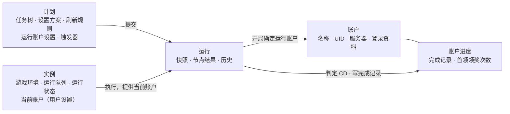
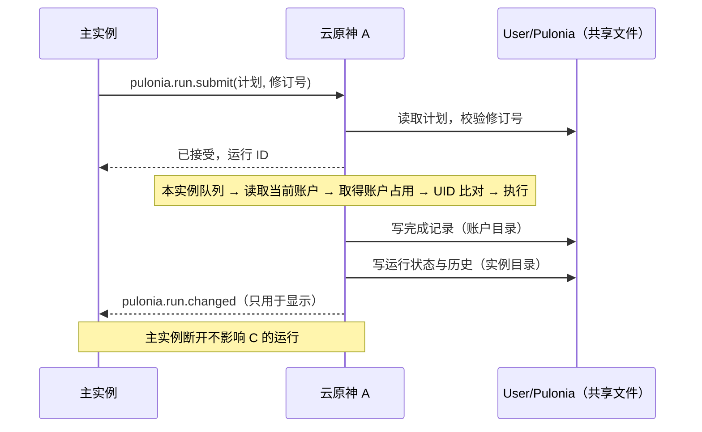

# 实例、账户、配置与路线 CD 统筹设计

状态：设计基线第 3 版，方向已确认，已实施。2026-10-31 基于 `refactor/20260930` 分支代码核对；第 13 节的 7 个步骤已于 2026-11-01 在该分支实施（尚未提交），待用户验收，遗留问题见[第 15 节](#15-实施记录)。第 3 节是实施前的代码问题。开发期允许不兼容改动，不做数据迁移，见第 11 节。

版本变化：

- 第 2 版：取消 UID 自动识别，每个实例当前运行哪个账户由用户设置。
- 第 3 版：
  - 切换账户时仍按 UID 找到并核验目标账户，必须一致。
  - 跟随当前账户的运行只比对 UID，不一致时提示，不阻止运行。
  - 账户增加服务器字段，决定路线 CD 的日切时区。
  - 狛荷屋的 UID 列表改为读取账户目录。
  - 触发器的执行实例可以多选，触发游标按执行实例记录。
- 第 3 版补充（2026-10-31）：定时触发器改为各执行实例自己检查，主实例不再替子实例检查或下发定时；计划热键只在主实例注册，只在主实例执行，子实例不支持热键触发。

相关文档：[三种实例的能力边界](instance-capability-boundaries.md)、[多实例命名管道协议](multi-instance-ipc.md)、[Pulonia 总览](pulonia/README.md)、[Pulonia 多账户](pulonia/accounts.md)、[结果、CD 与存储](pulonia/results-and-storage.md)、[执行](pulonia/execution.md)、[触发与热键](pulonia/scheduling.md)。

本文回答五个问题：

1. 实例、账户、配置、路线 CD 各是什么，彼此是什么关系。
2. 只有一个游戏账号的用户，怎样做到完全不用设置账户。
3. 多个实例同时运行时，怎样要求用户区分账户，避免记错进度或把账户挤下线。
4. 账户管理需要哪些功能，放在哪里。
5. 触发器保存在共享的计划里，多个实例同时存在时会不会重复触发。

本文统一使用“账户”一词，界面中的“账号”同步改为“账户”。游戏内按钮模板名（如 `SwitchAccount`）不受影响。

## 1. 模型

一次运行由三件事决定：

| 问题 | 由谁回答 | 说明 |
| --- | --- | --- |
| 做什么 | 计划 | 任务树、设置方案、触发器、运行账户设置 |
| 为谁做 | 账户 | 一个原神游戏账号，拥有自己的进度 |
| 在哪做 | 实例 | 一个能操作游戏的 BetterGI 进程，拥有自己的运行队列和“当前账户”设置 |

路线 CD 不单独存储，由两部分推算：

- **刷新规则**属于计划设置，说明一份路线完成后多久能再跑。
- **完成记录**属于账户进度，说明这个账户上次什么时候完整跑完这份路线。



归属规则：

- **账户属于 Pulonia。** 账户目录、完成记录、首领领奖次数都存在 `User/Pulonia` 下，由 Pulonia 的存储层读写。狛荷屋等其他模块使用的 UID 列表也来自账户目录。
- **实例拥有运行时的东西和一项账户设置**：游戏环境、任务锁、本实例的队列和运行状态，以及“当前账户”。实例不拥有配置，也不拥有进度。
- **进度跟着账户走。** 同一个账户今天在主实例跑、明天在云原神跑，用的是同一份完成记录。
- **配置既不跟实例走，也不跟账户走。** 需要按账户区分设置时，用不同的计划或设置方案表达，见第 7 节。
- **运行账户由设置决定，UID 用来核对。** 运行为哪个账户执行，取决于计划的运行账户设置和实例当前账户。指定账户的运行要求游戏中的 UID 与目标账户一致；跟随当前账户的运行只比对 UID，不一致时提示。

## 2. 术语

| 术语 | 定义 | 不要这样理解 |
| --- | --- | --- |
| 实例 | 一个 BetterGI 进程及其游戏环境：主实例、桌面分身或某个云原神网页版实例 | 把实例当成配置档案或账户 |
| 主实例 | 同一 Windows 用户下唯一的实例管理入口。负责启动、关闭子实例，把手动运行一步下发给子实例；它自己也执行任务，检查自己的定时触发器，并且是唯一注册计划热键的实例 | 认为子实例的运行或定时要靠主实例编排 |
| 子实例 | 桌面分身或云原神网页版实例。拥有完整界面和自己的运行队列，可以自己发起、调度和执行任务：自己检查执行实例包含自己的定时触发器，也接受主实例一步下发的运行。不注册计划热键 | 认为子实例只能执行主实例派发的节点，或认为子实例的定时由主实例代管 |
| 实例键 | 实例的稳定标识，重启后不变：`primary`、`child_session`、`webview:<小写实例名>` | 用进程号或 Windows 会话号标识实例 |
| 执行实例 | 一次运行在哪个实例执行，取代“执行目标” | 认为选择子实例后运行仍由主实例编排 |
| 一步下发 | 主实例请求子实例“运行计划 P”。子实例接受后自己准备快照、排队、执行和记录，之后不再依赖主实例 | 主实例逐个节点遥控子实例 |
| 账户 | Pulonia 中的一个原神游戏账号，以账户 ID 区分，显示为用户起的名称，带 UID 和服务器。没有登录资料也是账户 | 把账户等同于登录资料 |
| 我的账户 | 账户目录初始自带的账户。只有一个账号的用户始终只用它，不需要任何设置；它是唯一允许不填 UID 的账户 | 把它当成“当前登录的任何账号”的别名，那是旧“默认账号”的含义 |
| 实例当前账户 | 用户为实例设置的一项值：这个实例的游戏现在登录的是哪个账户。BetterGI 只在自己切换账户后改写它 | 认为 BetterGI 会自动检测并改写这项设置 |
| 运行账户设置 | 计划上的设置：跟随当前账户（默认，不切换），或指定账户（必要时切换） | 把“跟随当前账户”当成一个账户 |
| 运行账户 | 一次运行实际为哪个账户执行。运行开始时确定，写入运行记录 | 认为运行账户在提交时就已确定 |
| UID 核验 | 指定账户的运行在切换前后读取游戏中的 UID，必须与目标账户的 UID 一致，否则不执行业务节点 | 用于跟随当前账户的运行 |
| UID 比对 | 跟随当前账户的运行开始时读取游戏中的 UID，与当前账户的 UID 比较。不一致只提示，运行照常进行 | 把比对结果当作运行账户；运行账户仍是实例当前账户 |
| 账户占用 | 一个账户正被某个运行使用。同一账户同一时刻只能被一个运行占用，不论在哪个实例 | 当作账户“登录在哪里”的记录；它只在运行期间存在 |
| 账户进度 | 只属于某个账户的执行事实：完成记录和首领领奖次数 | 当作配置；它不进入计划和快照 |
| 路线 | 一份地图追踪 JSON 文件，以路线身份区分：仓库路线 `repository:<仓库 ID>/<小写相对路径>`，本地路线 `local:<小写绝对路径>` | 把同种材料的所有路线当成一条路线 |
| 刷新规则 | 路线完成后多久可以再执行：自动识别、不检查或自定义周期。属于计划的共享设置，运行时固定进快照 | 把刷新规则存进账户进度 |
| 完成记录 | 某个账户最近一次完整执行成功某份路线的时间。每个账户的每份路线只保留一条，不论该路线是否检查 CD | 当作历史明细；每次成功的明细在运行记录里 |
| 路线 CD | 按刷新规则和完成记录推算出的“暂不可执行”时段。不存储，每次判定都按当前规则和运行账户的服务器时区重新计算。状态有可执行、CD 中、已完成、未识别、不检查 | 认为存在一份独立的“CD 数据”；“清除记录”删除的就是完成记录 |
| 通用配置 | `User/config.json`，与账户和实例都无关的设置。所有实例共用，弱一致 | 把账户之间的差异写进通用配置 |
| Pulonia 配置 | 计划、设置方案、账户目录。所有实例共用，用修订号防止覆盖 | |
| 实例运行状态 | 一个实例的排队请求、活动运行、待归档运行，以及本实例负责的定时触发器的游标 | 把账户进度放进实例运行状态 |

### 2.1 停用的说法

| 旧说法 | 问题 | 改为 |
| --- | --- | --- |
| 默认账号（`default`） | 同一个 ID 同时表示“不切换”和“当前登录的任何账号”。进度记在它名下时，不同账号的 CD 混在一起 | 运行账户设置“跟随当前账户”。进度记在实例当前账户名下；只有一个账号时就是“我的账户” |
| 默认账号运行时读取的“实际 UID” | 读到什么 UID 都接受，又不参与 CD，只是记了一笔 | 跟随当前账户的 UID 比对，不一致时提示 |
| 账本、账本条目（`PuloniaTaskLedgerEntry`） | “账本”暗示逐笔记账，实际只保留最新一条。术语表定义为“仍约束执行的记录”，但不检查和已过期的记录也一直保留 | 完成记录 |
| 采集 CD、文件级路线 CD、collection cooldown | 同一概念有四种叫法 | 界面叫“路线 CD”，代码叫 route cooldown |
| 作用域 `cn/world/{身份}` | `cn` 是写死的，`world` 没有含义，`default` 不是身份 | 完成记录直接按账户存放，不再有作用域键 |
| 确认事实、确认事件（`confirmed_effects`） | 已删除额度框架留下的叫法 | 本次完成的路线（`route_completions`） |
| 账号参数资料（普通计划触发器的 `account_id`） | 不切换账号，只影响首领领奖次数的键 | 删除。运行账户由计划设置和实例当前账户决定 |
| 显示账号切换步骤（`multi_account_enabled`） | 只是界面偏好，却存在账户目录里 | 删除。指定账户的计划总是显示“切换账户”准备项 |
| 执行目标 | 与“执行实例”混用 | 执行实例 |

## 3. 现状问题

以下是 2026-10-31 实施前的代码问题，作为设计依据保留，已由第 13 节的 7 个步骤解决。

账户：

- **账户身份有三套。** 计划绑定和首领领奖次数用账号资料 ID；编辑页 CD 标记和运行预览用资料里填写的 UID；运行时 CD 用核验到的 UID，而且只在指定账号时使用。
- **默认账号的进度混在一起。** 普通计划和一条龙默认账号的 CD 都记在 `cn/world/default`。几个实例各登一个号时，一个号跑过的路线会让其他号跳过。
- **实例不知道自己在为哪个账户运行。** 没有“实例当前账户”的概念；一条龙默认账号会读一次 UID，普通计划完全不区分。
- **账户管理只是一个次级窗口。** 入口在新一条龙“更多”菜单里，不能测试切换，看不到某个账户的进度，也看不到哪些计划在用它。
- **服务器时区只有一份全局设置**（`OtherConfig.ServerTimeZoneOffset`），不同服务器的账户共用同一个日切时刻。
- **狛荷屋另有一套 UID 列表**（`User/AccountRecords/<uid>` 的子目录），手动添加，与 Pulonia 账户互不相关。

路线 CD：

- **进度存在主实例的运行状态里。** 账本存在主实例的 `state.json` 里，和运行队列混在一起。子实例无法自己记录，只能由主实例代写，这是“所有实例共用一个串行队列”的原因之一。
- **账本条目带着遗留字段。** `event_key`、`window_key`、`units` 都来自已删除的额度框架。
- **首领领奖次数另存一处，键不统一。** 它存在 `boss-rewards/` 下，按账号资料 ID 记，键可能是空字符串、`default` 或 `acc_…`，同一个当前登录账号会对应两个键。

实例：

- **只有主实例能协调 Pulonia 运行。** 子实例只执行主实例逐个派发的节点，不能在自己的界面运行计划。
- **所有执行实例共用一个串行队列。** 多个云原神不能同时跑；主实例断开时，子实例上正在执行的节点会被取消。
- **定时和热键只能在主实例执行，也不能指定执行实例。**

## 4. 账户

### 4.1 账户目录

- 账户目录 `User/Pulonia/accounts.json` 至少有一个账户。首次使用时自动建立“我的账户”。
- 账户字段：
  - `id`：`acc_` 加 16 位。
  - `name`：必填，目录内不重复。
  - `uid`：完整 9 到 10 位，目录内不重复。目录中最多一个账户可以不填 UID，初始的“我的账户”就是这个账户；之后新增的账户必须填写。“我的账户”改名后仍是普通账户，没有其他特殊身份；已填的 UID 只有在没有其他账户缺 UID、也没有计划指定它时才能清空。
  - `server_time_zone`：服务器时区，取值与触发器相同：`UtcPlus8`（国服、亚服、港澳台）、`Europe`（欧服）、`America`（美服）。新增账户时默认取通用配置中的服务器时区。
  - 登录资料：`login_mode`、`image_path`、`list_text`、`credential_reference`，可选，只有需要 BetterGI 自动切换到这个账户时才填写。含义和凭据规则不变，见[多账户 · 凭据](pulonia/accounts.md#凭据)。
- 填写 UID 的方式：手动输入，或在账户页点“从当前游戏读取”（要求本实例游戏停在主界面）。
- “我的账户”没有 UID 时：不能被计划指定，不做 UID 比对，也不出现在狛荷屋。填写后这些功能自动可用。
- 列表顺序可以调整。
- 修改 UID 时，狛荷屋中该账户的数据目录随之改名；新 UID 已有狛荷屋数据时拒绝修改，清空一个已有狛荷屋数据的 UID 也拒绝。
- 删除账户时，一并删除它的账户进度、凭据、不再被引用的账户图片和狛荷屋记录，删除前列出这些数据并确认。以下情况拒绝删除：
  - 仍有计划指定该账户。
  - 它是某个实例的当前账户，需先把这些实例改为其他账户。
  - 账户正被运行占用。

### 4.2 实例当前账户

- 每个实例保存一项设置：本实例的游戏现在登录的是哪个账户。存在 `User/Pulonia/instances/<目录名>/settings.json` 的 `current_account_id` 中，值为 `null` 表示“未确定”。
- 初始值：
  - 实例首次使用时，取账户列表的第一个账户。只有一个账号的用户就是“我的账户”，永远不用修改。
  - 新建云原神实例时，如果目录有多个账户，在新建窗口里选择，默认第一个。
- 修改入口：
  - 本实例标题栏的账户徽标，以及账户页顶部。
  - UID 比对不一致的提示中，可以一键改为读到的 UID 对应的账户（如果目录里有）。
  - 主实例还可以在标题栏实例列表和“运行于”中修改子实例的当前账户。设置是共享文件，不经过 IPC。
- 修改立即保存。正在运行的任务不受影响，下一次运行开始时生效。
- BetterGI 只在两种情况下自己改写这项设置：
  - 指定账户的运行切换并核验成功后，改为目标账户。
  - 切换中途失败时（例如已登出、停在登录界面），改为“未确定”。之后跟随当前账户的运行会进入待处理，直到用户重新选择。

### 4.3 运行账户设置

普通计划和一条龙都用同一个字段 `account_id`：

| `account_id` | 界面显示 | 含义 |
| --- | --- | --- |
| 空（默认） | 跟随当前账户 | 不切换，为实例当前账户执行 |
| `acc_…` | 指定账户：乙 | 为乙执行。游戏中登录的不是乙时，先自动切换到乙 |

- 取代 `accounts: List<PuloniaTaskAccountBinding>`，改为单值，两种计划都支持。
- 只能指定填写了 UID 的账户，因为切换和核验都要按 UID 找到目标。
- 触发器不再有 `account_id`，不能覆盖计划的设置。
- 不含游戏节点的计划（只有 Shell、C#）不确定运行账户。

### 4.4 运行开始时确定运行账户

含游戏节点的运行，在执行第一个节点前确定运行账户。实例当前账户在这时读取最新设置，而不是在提交时读取：队列中前一个运行切换了账户，后面跟随当前账户的运行就为切换后的账户执行。

**跟随当前账户：**

1. 运行账户就是实例当前账户。当前账户为“未确定”时，运行进入待处理，提示先设置本实例当前账户。
2. 取得账户占用（4.5）。
3. UID 比对：当前账户填写了 UID，且游戏此时停在主界面时，读取 UID（只截图，不按键，最多约 3 秒）。读取方法与切换后的核验相同：连续两帧新截图得到相同的完整 UID 才采用。

| 比对结果 | 处理 |
| --- | --- |
| 一致 | 记为“UID 一致” |
| 不一致 | 提示后继续运行，进度仍记在实例当前账户名下（见下文） |
| 读不到（不在主界面或识别失败） | 记为“未比对”，不提示 |
| 当前账户没有 UID | 不读取，记为“未比对” |

不一致时的提示：

- 遮罩日志输出警告，本实例弹出通知：“本实例当前账户是甲（UID 尾号 1111），游戏中读到尾号 2222。本次仍按甲记录进度。”
- 目录中有 UID 为 2222 的账户时，通知带“把当前账户改为乙”按钮，修改从下一次运行开始生效。
- 运行记录写入警告和读到的 UID，执行记录列表用提示色标出这次运行。
- 标题栏账户徽标显示提示色，直到当前账户被修改或下一次比对一致。

跟随当前账户的运行只在开始时比对一次，节点执行中不再读取 UID。

**指定账户乙：**

1. 取得乙的账户占用（4.5）。取得失败时直接进入待处理，不切换，避免切换后才发现乙正在别处运行。
2. 账户准备，沿用现有切号器（[账户准备与 UID 核验](pulonia/accounts.md#账户准备与-uid-核验)）：先回到主界面读取 UID。
   - 等于乙的 UID：不切换。
   - 不等于，且实例是本机 PC 官服窗口（主实例或桌面分身）、乙有登录资料：先按 4.6 检查，再切换，切换后读取 UID，必须等于乙的 UID。
   - 不等于，且实例是云原神，或乙没有登录资料：不运行，进入待处理：“游戏中登录的不是乙，本实例不能切换到乙”。界面在提交前按实例当前账户预先提示。
3. 核验成功后把实例当前账户改为乙，核验结果与“切换账户”节点结果一起落盘，之后才执行业务节点。
4. 运行中需要游戏的节点按现有规则再次核验 UID（是否每个节点都核验见 Pulonia 待定项 D7）。核验失败时运行进入待处理。

**运行记录**写入：

- `account_id`：运行账户。
- `account_source`：`instance_current`（实例当前账户）或 `specified`（计划指定）。
- `verified_uid`：指定账户时为核验通过的 UID；跟随当前账户时为空。
- `uid_check`：跟随当前账户时为 `matched`、`mismatched`（另记读到的 UID）或 `skipped`；指定账户时为空。

**续跑**沿用原运行的运行账户：

- 原运行是指定账户的，按指定账户的规则核验原 `verified_uid`。
- 原运行是跟随当前账户的，要求本实例当前账户与原运行账户相同，不同时提示先修改；相同则照常做 UID 比对。

### 4.5 账户占用

- 同一账户同一时刻只能被一个运行占用，不论在哪个实例。游戏同样不允许一个账号同时在两处登录。
- 运行在确定运行账户后、执行第一个业务节点前取得占用，运行结束时释放。指定账户的运行在切换之前取得。排队中的运行不占用。
- 实现：运行期间以“允许他人读、不允许他人写”的方式打开 `User/Pulonia/accounts/<账户 ID>/run.lock`，写入实例键、运行 ID 和开始时间。进程退出时由系统释放句柄，崩溃不会留下占用。
- 取得失败时，运行进入待处理，不排队等待，因为这几乎总是设置错误。提示内容：“账户“我的账户”正在云原神 A 运行。多个实例同时运行时，请为每个实例设置不同的当前账户。”
- 界面提前检查：手动运行，或在“运行于”、触发器执行实例中选择多个实例时，若目标实例的当前账户与正在运行的账户重复，或几个选中实例的当前账户相同，提交或保存前弹出说明，用户可以坚持提交或保存。手动运行时选“否”会展开“运行于”，在那里就地修改各实例的当前账户；不另设带账户编辑的对话框。提交前检查由 `PuloniaRunTargetCheck` 完成，同时检查当前账户未确定、云原神不能切换和切换会挤下线（4.6）。

这条规则是“多个实例同时运行时要求区分账户”的入口。只用一个实例的用户永远不会遇到它。

### 4.6 切换前检查

- 切换到乙之前，如果另一个在线实例的当前账户是乙，这次切换会把那边挤下线：
  - 在本实例界面手动运行：弹出提示，用户确认后继续。
  - 触发器提交和主实例下发：不切换，运行进入待处理。
- 在线判断：每个实例运行期间以同样的方式打开 `User/Pulonia/instances/<目录名>/online.lock`，其他实例尝试打开失败即视为在线。不经过 IPC。

### 4.7 用户什么时候需要设置账户

| 情况 | 用户需要做什么 |
| --- | --- |
| 只有一个账号，在主实例、桌面分身、云原神之间轮流使用 | 什么都不用做 |
| 有多个账号，在同一个实例里手动换号后运行 | 换号后把标题栏的当前账户改成对应账户。忘了改时，如果账户填了 UID，运行开始会提示不一致，可在提示中一键修改 |
| 多个实例同时运行 | 为每个实例设置不同的当前账户。没设置时，提交前会提示，并可在提示里直接设置 |
| 让 BetterGI 自动切换账号 | 为目标账户填写 UID 和登录资料，并把计划设为“指定账户” |

### 4.8 UID 的用法与取舍

| 场景 | 读取 UID | 不一致时 |
| --- | --- | --- |
| 指定账户：切换前 | 回到主界面后读取 | 切换；不能切换时进入待处理 |
| 指定账户：切换后、节点开始时 | 读取 | 进入待处理，不执行业务节点 |
| 跟随当前账户：运行开始 | 只在主界面时读取，不按键 | 提示，继续运行 |
| 跟随当前账户：节点执行中 | 不读取 | — |
| 账户页“从当前游戏读取” | 只在主界面时读取 | — |

跟随当前账户只提示不阻止，带来以下结果：

- 只用一个账号的用户，即使从未填写 UID，也永远不会被拦下。
- 从七圣召唤对局等特殊界面开始的任务，开局读不到 UID，照常运行。
- 用户在游戏里手动换号、但没有修改实例当前账户时，运行仍按设置的账户记录进度。账户填了 UID 且开局在主界面时，用户会收到提示；否则 BetterGI 发现不了。错记的完成记录可以在账户页清除。

[Pulonia 需求](pulonia/requirements.md#边界分级)中“可能在错误账户上执行”这一必须处理的边界因此分成两种：

- 指定账户：BetterGI 负责，切换后严格核验 UID，失败不执行。
- 跟随当前账户：用户负责实例当前账户与游戏一致，BetterGI 比对 UID 并提示，不保证。

### 4.9 狛荷屋的 UID 列表

狛荷屋不再维护自己的 UID 列表：

- UID 下拉框列出账户目录中填写了 UID 的账户，显示为“名称（UID）”，顺序与账户列表一致。打开页面时默认选中本实例当前账户。
- 删除狛荷屋的“新增 UID”浮窗，改为“管理账户”，跳转到账户页。
- 账户菜单只保留“清空库存记录”。删除账户只在账户页进行，会一并删除狛荷屋记录。
- 导入交换文件时，文件中的 UID 不在账户目录里，就提示“创建账户“账户 尾号 5678”并导入？”，确认后先建账户再导入。
- 数据仍按 UID 存在 `User/AccountRecords/<uid>/`，格式不变；`InventoryStore` 不再从目录名枚举 UID，改为由页面传入账户目录中的 UID。
- 狛荷屋通过 `IPuloniaAccountService` 读取账户列表、订阅账户变化。依赖方向是狛荷屋依赖 Pulonia 账户服务，反过来不依赖。

## 5. 路线 CD 与账户进度

### 5.1 判定链

路线 → 刷新规则（计划设置，快照中固定）→ 完成记录（运行账户的进度）→ 路线 CD 状态。

- 唯一的判定函数不变：`GetStatus(刷新规则, 最近完成记录, 现在, 服务器偏移)`。规则表、模式、状态和原因码都沿用[文件级路线 CD](pulonia/results-and-storage.md#文件级路线-cd)。
- 判定时只读运行账户的完成记录。地图追踪节点需要游戏，所以含地图追踪节点的运行一定有运行账户。
- 服务器偏移取运行账户的 `server_time_zone`，在运行开始确定运行账户时写入运行记录，续跑沿用。不再在入队时按通用配置填写。
- 刷新规则改变后，从原完成时间按新规则重新计算，不改写完成记录。

### 5.2 完成记录

存储在 `User/Pulonia/accounts/<账户 ID>/route-completions.json`：

```json
{
  "schema_version": 1,
  "completions": [
    {
      "route": "repository:official/pathing/地方特产/蒙德/落落莓/落落莓-01.json",
      "completed_at": "2026-10-30T20:15:00Z",
      "run_id": "run_20261031-041500-ab12",
      "task_address": "<节点地址>",
      "attempt": 1,
      "instance": "webview:小号a",
      "rule": { "mode": "rolling", "hours": 46, "material": "落落莓", "source": "目录自动识别" }
    }
  ]
}
```

规则：

- 一份路线文件完整执行成功后才写入，每份路线只保留最新一条。不检查 CD 和未识别规则的路线，成功后也同样写入。
- `rule` 是记录时的刷新规则，只用于在总览里显示“记录时规则”。判定 CD 时使用当前规则。
- 同一运行、同一节点、同一次尝试重复写入时幂等，按 `run_id`、`task_address`、`attempt` 判断。
- 每个账户最多 10 万条，沿用原上限。
- 与账本条目相比，去掉了 `scope_key`、`effect_key`、`event_key`、`window_key`、`units`、`next_eligible_at`。原 Pulonia 待定项 D19 随之完成。
- 运行记录中“本次完成的路线”（原 `confirmed_effects`）使用同一结构。
- **清除记录**：任一实例的界面都可以清除，在 `.writer.lock` 内读改写。清除不能撤销，也不影响运行历史。不提供“标记为已采集”，沿用原 D18 的决定。

### 5.3 首领领奖次数

- 移到 `User/Pulonia/accounts/<账户 ID>/boss-rewards.json`。键为（计划 ID、节点 ID、重置批次），值为次数。
- 按运行账户记录，不再用空字符串或 `default` 作键。

### 5.4 写入顺序

完成记录在账户目录，节点结果在实例运行状态，两者不能在一次文件替换里提交。写入顺序固定为：

1. 先写完成记录：在 `.writer.lock` 内读改写，耐久替换。
2. 再写节点结果和本次完成的路线：写入本实例的 `state.json`。

两步之间崩溃时，完成记录已经存在，运行在重启后转为“已中断”。续跑或下次运行时，这份路线会按 CD 跳过，不会重复执行。第 1 步写入失败时，按现有规则熔断，停止本实例的自动运行。

### 5.5 跨实例读取

- 各实例按文件修改时间缓存账户进度。运行开始时、地图追踪节点判定 CD 前、页面每分钟刷新时比较修改时间，有变化才重新读取。
- `LedgerChanged` 改为 `AccountProgressChanged`。本进程写入后立即触发；其他实例的写入靠修改时间比较发现，页面最多延迟 1 分钟显示。
- 账户进度的读写不经过 IPC。

### 5.6 界面按哪个账户显示 CD

任务树 CD 标记、运行预览和路线 CD 表单按以下规则选择账户，日切时区取该账户的服务器时区：

| 计划的运行账户设置 | 显示的账户 |
| --- | --- |
| 指定账户 | 该账户 |
| 跟随当前账户 | 本实例当前账户 |

账户目录有多个账户时，任务计划页“任务”页签顶部和运行预览窗口显示“CD 按账户：乙 ▾”，可以临时切换查看其他账户。这个选择只影响该页面的显示，不修改计划和实例设置；任务计划页切换计划或离开页面后恢复按计划设置。“任务”页签顶部的“查看路线 CD”放在“预览本次执行”旁，跳到账户页时选中这里显示的账户。

新一条龙页没有任务树 CD 标记和运行预览，所以不放“CD 按账户”；“更多”菜单提供“查看路线 CD”，跳到账户页，选中这份配置按上表选出的账户，并按这份配置筛选。

### 5.7 命名与代码对照

| 现名 | 新名或处理 |
| --- | --- |
| `PuloniaTaskLedgerEntry` | `PuloniaRouteCompletion` |
| `PuloniaCollectionCooldown`（静态类） | `PuloniaRouteCooldown` |
| `PuloniaCollectionCooldownPolicy` | `PuloniaRouteRefreshRule` |
| `PuloniaCollectionCooldownState` | `PuloniaRouteCooldownState` |
| `PuloniaCollectionCooldownRules`（目录规则表） | `PuloniaRouteRefreshRuleCatalog` |
| `PuloniaCollectionCooldownOverviewViewModel` | `PuloniaRouteCooldownOverviewViewModel` |
| `PuloniaCollectionCooldownMode`、`PuloniaCollectionCooldownRuleSource` | `PuloniaRouteRefreshMode`、`PuloniaRouteRefreshRuleSource` |
| 参数 `collection_cd`、设置项 ID `collection.cooldown` | `route_cd`、`route.cooldown` |
| 快照字段 `collection_cooldown` | `refresh_rule` |
| 跳过结果中的 `collection_*` 数据键 | `route_*` |
| `PuloniaTaskConfirmedEffect`、`confirmed_effects` | `PuloniaRouteCompletion`、`route_completions` |
| `IPuloniaTaskService.ListLedgerAsync`、`ClearCollectionCooldownAsync`、`LedgerChanged` | `IPuloniaAccountService.ListRouteCompletionsAsync(accountId)`、`ClearRouteCompletionsAsync(accountId, routes)`、`AccountProgressChanged` |
| 原因码 `pathing.cooldown_active`、`pathing.cooldown_completed` | 不变 |
| `PuloniaGenshinAccountProfile.DefaultId`、`PuloniaCollectionCooldown.DefaultScopeIdentity` | 删除 |
| `PuloniaTaskRunRecord.VerifiedUid` | 保留，只在指定账户时有值；新增 `account_id`、`account_source`、`uid_check` |
| 请求的 `ServerUtcOffsetMinutes` | 改为运行开始时按运行账户填写 |
| 请求的 `AccountId` | 删除。运行账户只由计划设置和实例当前账户决定，续跑按原运行确定 |
| `PuloniaTaskService.Remote`、`PuloniaRemoteExecutionBroker`、`PuloniaRemoteNodeHost` | 删除。一步下发由主实例的 `PuloniaTaskService` 发送 `pulonia.run.*`，子实例的 `PuloniaTaskService` 接收并入队 |
| `IPuloniaGenshinAccountSwitcher.PrepareAsync` 对默认账号“读到任意 UID 即返回”的分支 | 删除；新增只读、不按键的 `TryReadUidAsync` 供 UID 比对和账户页使用 |

分层上新增 `PuloniaAccountService`（实现 `IPuloniaAccountService`），属于应用服务层，负责账户目录、实例当前账户、账户占用、切换前检查、UID 比对和账户进度读写。存储仍由 `PuloniaTaskStore` 负责，账户相关部分拆为 `PuloniaTaskStore.Accounts` 和 `PuloniaTaskStore.AccountProgress` 两个 partial。`PuloniaTaskService` 通过 `PuloniaAccountService` 确定运行账户、判定和写入完成记录，不再直接持有账本。

`Bv.Uid` 与 JS 的 `genshin.uid()` 不属于 Pulonia 账户，本设计不改动。

## 6. 实例与执行

### 6.1 实例键

实例仍是三种，定义见[三种实例的能力边界](instance-capability-boundaries.md#1-三种实例)。

| 实例 | 实例键 | 实例目录 |
| --- | --- | --- |
| 主实例 | `primary` | `instances/primary` |
| 桌面分身 | `child_session` | `instances/child_session` |
| 云原神实例 | `webview:<小写实例名>` | `instances/webview-<小写实例名>` |

云原神实例名沿用现有规则（1 到 32 个字符，不含非法字符和保留名），实例目录名最长 40 个字符。

目前每个 Windows 用户同时只有一个桌面分身（`WTSGetChildSessionId` 只返回一个会话号），所以桌面分身的实例键不带会话号。会话号在分身重建后可能变化，只用于运行时寻址。原来按会话号区分的 `PuloniaTaskExecutionTarget` 已随逐节点派发一起删除。

### 6.2 每个实例自己协调运行

- 每个实例都有完整的 Pulonia 协调器：队列、快照、确定运行账户、执行、运行状态和历史。取代“只有主实例是协调器”的现状。
- 同一实例内串行，任务锁不变；不同实例之间并行，同一账户由账户占用保证不并行。
- 实例运行状态存在 `User/Pulonia/instances/<目录名>/state.json`，只由本实例写入。内容是排队请求、活动运行、待归档运行和本实例负责的定时触发器的游标；不再包含完成记录。
- 子实例从自己界面、自己的定时触发器或命令行 `--pulonia-run` 提交的运行，都在本实例执行，不经过 IPC。每个实例都运行 `PuloniaTaskTriggerHost`：检查本实例负责的定时触发器、处理 `--pulonia-run`；只有主实例的 `PuloniaTaskTriggerHost` 注册计划热键。

### 6.3 一步下发

主实例只能整次下发运行：

| 操作 | 方向 | 内容 |
| --- | --- | --- |
| `pulonia.run.submit` | 主 → 子 | 计划 ID、计划修订号、执行范围（`target_task_id`） |
| `pulonia.run.cancel` | 主 → 子 | 运行 ID |
| `pulonia.run.changed` | 子 → 主 | 运行 ID、状态、当前节点消息。只回报主实例下发的运行 |

- 子实例收到 `pulonia.run.submit` 后读取共享的计划：
  - 修订号不一致时拒绝，提示“计划已变更，请重新运行”。
  - 修订号一致时生成快照，放入本实例队列，立即回复运行 ID。
- 运行账户由子实例按 4.4 自己确定，使用子实例的当前账户。
- “运行于”只列出在线的子实例。
- 主实例崩溃或 IPC 断开时，不取消子实例已接受的运行。断开期间主实例页面把这些运行显示为“连接断开，状态未知”，不能远程停止，需要在子实例界面停止。子实例重新连上主实例后，补发一次主实例所下发、尚未结束的运行状态。主实例的正常退出仍按 A2 处理。
- 一步下发只用于主实例界面上的手动运行（“运行于”选择了子实例）。定时和热键都不经过 IPC，见 6.4。
- 删除 `pulonia.node.start`、`pulonia.node.cancel`、`pulonia.node.finished`，以及 `PuloniaRemoteExecutionBroker` 和 `PuloniaRemoteNodeHost`。约 900 KB 的派发负载上限也不再需要。
- 方向规则不变：子实例不能向主实例或其他子实例下发运行。



### 6.4 触发器

#### 6.4.1 多个实例同时存在时会不会重复触发

不会。触发器嵌在共享的计划文件里，所有实例都能读到，但每个定时触发器只由它的执行实例检查：

- 每个实例的 `PuloniaTaskTriggerHost` 每秒检查一次定时，只处理执行实例包含本实例的触发器；`instances` 为空的触发器只由主实例处理。
- 一个（触发器，执行实例）组合只有一个检查者，就是该执行实例自己。实例键在同一 Windows 用户下不会同时有两个进程：主实例只有一个，桌面分身同时只有一个，同名云原神实例由实例名互斥体保证只运行一个。
- 触发游标存在执行实例自己的 `state.json` 里，入队与游标前移在同一次替换中提交。实例重启后按游标继续，不会重放已处理的时刻。
- 计划热键只在主实例注册、只在主实例执行（6.4.3），不会在多个实例上响应。

同一时刻有多个定时触发器到点时：

| 情况 | 结果 |
| --- | --- |
| 执行实例不同 | 各实例各自提交，并行运行 |
| 执行实例相同 | 依次进入该实例的队列，串行运行，忙碌时按各触发器的忙碌策略处理 |
| 一个触发器选了多个执行实例 | 每个执行实例各自检查、各自提交一次，并行运行 |

#### 6.4.2 定时触发

- 触发器的 `instances` 字段是执行实例键的列表，为空时表示只在主实例执行。这个字段只对定时触发器有效。
- 计划指定了账户时，只能选一个执行实例，因为同一账户不能同时运行。
- 选了多个执行实例时，保存前按 4.5 检查这些实例的当前账户是否重复。
- 到点时由执行实例在本地提交，进入本实例的队列，不经过 IPC。主实例不替子实例检查定时，也不替它下发。
- 游标按（计划、触发器）记录在执行实例的 `state.json` 中。一个触发器选了 A、B、C 时，三个实例各有一份游标，各自前移，互不影响。触发器的执行实例去掉本实例后，本实例把它的游标当作孤儿剔除。
- 触发器是计划的一部分，任一实例的界面都可以编辑，包括执行实例。编辑共享计划不算跨实例控制：到点运行仍由执行实例自己检查和决定。
- 执行实例没有运行时，没有进程检查它的定时。实例启动后按自己的游标和补触发规则（`catch_up`、`window_minutes`）处理遗漏：仍在允许延迟时间内的最近一次补跑，超过的记为遗漏。不改到其他实例执行，主实例也不替它启动实例。
- 执行实例已被删除（例如删掉了云原神实例）时，没有实例会检查这个组合，触发设置页提示“执行实例不存在”。
- 忙碌策略在本实例的队列上判断：“忙碌”指本实例里同一计划已有未结束的请求。
- 触发器的 `server_time_zone` 只用于解释 Cron，与账户的服务器时区相互独立。新建触发器时，计划指定了账户就默认取该账户的服务器时区，否则默认 `UtcPlus8`。
- 计划修改的感知沿用现有规则：本实例保存计划后下一轮重读，其他情况每 30 秒比较计划文件修改标记。在另一个实例修改触发器，最多 30 秒后生效。
- 触发状态（等待、已提交、遗漏等）只在执行实例的内存中。触发设置页实时显示本实例负责的部分；其他实例负责的部分，读它们 `state.json` 中的游标和 `online.lock`，显示“上次触发时间”和是否在线。

#### 6.4.3 计划热键

- 热键触发器只在主实例注册，按下后只在主实例执行，没有执行实例选项；保存时要求 `instances` 为空。
- 子实例不注册计划热键，不支持热键触发。原因：云原神实例与主实例在同一个 Windows 会话里，同一组合键只能被一个进程全局注册，键鼠监听又会在每个进程里重复响应；桌面分身只在焦点位于主实例的分身窗口时才收到键盘输入。
- 需要在子实例运行计划时，用子实例自己的界面、定时触发器，或主实例的“运行于”。

### 6.5 执行记录

- 历史目录 `User/Pulonia/history/<planId>/<runId>.json` 由所有实例共用，每个实例只写自己的运行，运行 ID 不重复。
- 运行记录增加 `instance`、`account_id`、`account_source`、`uid_check`。
- 任一实例的执行记录页都显示全部实例的运行：已结束的运行从历史目录读取，排队和运行中的运行只读各实例的 `state.json`。页面可见时每 5 秒比较其他实例 `state.json` 和历史目录的修改时间，有变化才重新读取。
- 运行 ID 生成时除了本实例的运行，还检查共享历史目录中是否已有同名文件。历史写入沿用“同一运行已存在且内容不同时拒绝覆盖”，万一重复也不会互相覆盖。
- 停止运行：每个实例只能停止本实例的运行；主实例还可以停止自己下发的运行。
- 续跑在发起续跑的实例中执行，运行账户按 4.4 的续跑规则确定。

## 7. 配置

| 层 | 内容 | 位置 | 谁写 | 并发行为 |
| --- | --- | --- | --- | --- |
| 通用配置 | 截图、快捷键、键位、游戏路径、通知、旧功能参数、默认服务器时区 | `User/config.json` | 任意实例 | 后写者覆盖，弱一致（现状） |
| Pulonia 配置 | 计划、设置方案、计划顺序、账户目录 | `User/Pulonia/plans`、`profiles`、`accounts.json` 等 | 任意实例 | 修订号检查，冲突时报错（现状） |
| 实例设置 | 实例当前账户 | `User/Pulonia/instances/<目录名>/settings.json` | 该实例；主实例也可修改子实例的设置 | 原子替换，后写者覆盖 |
| 账户进度 | 完成记录、首领领奖次数 | `User/Pulonia/accounts/<ID>/` | 任意实例 | `.writer.lock` 内读改写，不丢更新 |
| 实例运行状态 | 队列、活动运行、待归档运行、本实例负责的定时触发器的游标 | `User/Pulonia/instances/<目录名>/state.json` | 该实例 | 单写者 |
| 运行历史 | 已结束的运行 | `User/Pulonia/history/` | 执行该运行的实例 | 按运行 ID 幂等写入 |
| 狛荷屋记录 | 库存、事件、快照 | `User/AccountRecords/<uid>/`，UID 列表来自账户目录 | 任意实例 | 狛荷屋自己的跨进程互斥（现状） |
| 实例差异 | 云原神固定用 WGC 截图，桌面分身固定以 1920×1080 窗口化启动 | 代码 | — | — |

- **多配置用计划和设置方案表达。** 可以每个账户一份一条龙配置，也可以共用一份计划，在节点上挂不同的设置方案。
- **通用配置只有一份。** 不做多份配置档案，也不按实例或账户拆分 `config.json`。旧一条龙、调度器和独立任务页读的是通用配置，不区分账户；需要按账户区分时改用 Pulonia。通用配置的服务器时区只作为新增账户的默认值，以及旧功能和 JS `ServerTime` 的时区。
- **不做“账户养成配置”。** 此前讨论过把队伍名等字段从 `config.json` 移到账户下，现在不做：队伍、战斗策略等已经是 Pulonia 的共享设置，可以按计划和设置方案区分。
- **实例当前账户是唯一按实例保存的 Pulonia 设置。** 它描述“这个游戏环境登录着谁”，不描述“怎么跑”，所以不违反“实例差异写在代码里”的原则。
- **子实例会写 `User/Pulonia`。** 原 Pulonia 待定项 D15 的结论：`.writer.lock` 和账户目录的修订号保留。

## 8. 存储布局

```text
User/Pulonia/
├─ plans/  profiles/  plan-order.json  plan-view-state.json   计划与设置方案（不变）
├─ accounts.json                       账户目录
├─ account-images/                     账户标识图片（不变）
├─ accounts/<账户 ID>/
│  ├─ route-completions.json           完成记录
│  ├─ boss-rewards.json                首领领奖次数
│  └─ run.lock                         账户占用（运行期间打开）
├─ instances/<实例目录名>/
│  ├─ settings.json                    实例当前账户
│  ├─ state.json                       实例运行状态（格式版本 7）
│  └─ online.lock                      在线标记（实例运行期间打开）
├─ history/<planId>/<runId>.json       运行历史（所有实例共用）
├─ imports/                            旧配置导入报告
├─ .writer.lock                        跨进程写锁
└─ ScriptResources/                    脚本仓库与任务资源（不变）

User/AccountRecords/<uid>/             狛荷屋记录（格式不变，UID 列表来自账户目录）
```

根目录不再有 `state.json`、`state.json.bak` 和 `boss-rewards/`，旧文件不转换（第 11 节）。实例运行状态仍按现有规则写入 `.bak` 并做备份回退。

## 9. 界面

### 9.1 导航

Pulonia 分组为：任务计划、新一条龙、执行记录、账户（新增）。所有实例都显示这四个页面。

### 9.2 标题栏账户徽标

- 账户目录有多个账户时，每个实例的标题栏显示“账户：乙 ▾”，点击可以改为其他账户或“管理账户”。
- 只有一个账户时不显示。
- 当前账户为“未确定”，或最近一次 UID 比对不一致时，徽标显示为提示色，悬停显示原因。

### 9.3 账户页

- **顶部：本实例当前账户**，带下拉框，可以直接修改。
- **左侧：账户列表。** 每行显示：
  - 名称和 UID 尾号。
  - 作为哪些实例的当前账户，如“主实例、云原神 · 小号A”。
  - 是否正在运行，如“运行中 · 云原神 · 小号A”。
  - 是否可以自动切换（是否有登录资料）。
  - 列表上方是“新增账户”：填写名称、UID 和服务器，UID 可以从当前游戏读取。
- **右侧：账户详情，分为五页。**
  - 概况：名称、UID、服务器、作为哪些实例的当前账户、最近一次运行，以及指定了该账户的计划（点击跳转）。
  - 登录资料：现有账号管理窗口的全部内容（采集或导入图片、列表文字、密码），另加“测试切换”。测试切换在本实例取得游戏租约，切换到该账户并核验 UID，成功后把本实例当前账户改为该账户。云原神实例中这个按钮不可用，提示“云原神实例不能切换账户”。
  - 路线 CD：原“路线 CD”总览，固定为当前账户，可按计划、状态、关键词筛选，可清除记录。
  - 首领领奖：各计划节点在本重置周期内的领奖次数。
  - 狛荷屋：跳转到狛荷屋页面并选中该账户。没有 UID 时提示先填写。
- **账户操作菜单**：改名、调整顺序、删除账户。
- **保存方式**：账户详情（名称、UID、服务器、登录资料）是草稿，点“保存”后一次保存，沿用原账号管理窗口的修订号检查和“先存目录、后写凭据”的顺序。本实例当前账户的修改立即保存。
- **只有一个账户时**，列表收起，直接显示“我的账户”的详情，“新增账户”按钮仍在页首。页首说明：“只有一个账号时不需要任何设置。有多个账号时，在这里添加账户，并在标题栏选择每个实例当前运行的账户。”
- 原新一条龙“更多 → 账号管理”和“切换账号”面板里的“管理账号与登录资料”按钮，都改为跳转到账户页。`PuloniaGenshinAccountsWindow` 删除。

### 9.4 任务计划页与新一条龙页

- 两个页面的计划标题旁都有“运行账户”：跟随当前账户，或指定账户（只列出有 UID 的账户）。目录只有一个账户、且计划为跟随当前账户时不显示。
- 指定账户的一条龙，清单首位显示“切换账户”准备项。删除“显示账号切换步骤”。
- 主实例在有子实例在线时显示“运行于”，改为多选：
  - 每项显示实例名和当前账户，如“云原神 · 小号A — 乙”，账户可以就地修改。
  - 指定账户的计划只能选一个实例，默认选中当前账户就是该账户的实例。
  - 跟随当前账户的计划可以选多个实例，每个实例各提交一次运行。
  - 提交前按 4.5 检查账户重复。
- 任务树 CD 标记按 5.6 选择账户。
- 删除任务计划页的“路线 CD”页签，改为“查看路线 CD”入口，跳到账户页并带上当前计划的筛选。“预览本次执行”保留。

### 9.5 触发设置

- 删除普通计划的“账号参数资料”下拉框和一条龙的“运行账号”说明。
- 定时触发器增加“执行实例”，多选：主实例、桌面分身，以及已建立的各云原神实例（列出全部实例名，不要求在线）。计划指定了账户时变为单选。说明文字：“到点时由执行实例自己检查并运行，实例需要开着；没开时，启动后按补触发规则处理。”
- 热键触发器不显示“执行实例”，说明文字：“计划热键只在主实例生效。”
- 选了多个执行实例时，保存前按 4.5 检查当前账户是否重复。
- 计划指定了账户、执行实例是云原神，且该云原神实例的当前账户不是这个账户时，保存前提示：“云原神实例不能切换账户，到点时需要该实例登录着乙。”
- 触发状态按执行实例分别显示：本实例负责的部分显示实时状态（已提交、已合并、遗漏等）；其他实例只显示游标记录的上次处理时刻和是否在线，例如“云原神 · 小号A：在线，已处理到 04:30；云原神 · 小号B：未运行”。游标在提交、合并和遗漏时都会前移，所以从其他实例看不出那一次是否真的提交了运行，要看执行记录。

### 9.6 执行记录页

- 列表增加“实例”和“账户”两列。只有一个账户时隐藏账户列；没有子实例的运行记录时隐藏实例列。UID 比对不一致的运行用提示色标出。
- 删除“路线 CD”页签，路线 CD 统一在账户页查看。
- 详情的“运行信息”显示执行实例和运行账户，例如“乙 · 本实例当前账户 · UID 一致”“丙 · 计划指定 · 已核验 UID”“甲 · 本实例当前账户 · 游戏中读到尾号 2222”。

### 9.7 主实例标题栏的实例列表

每个在线子实例除了名称，再显示当前账户和正在运行的计划名。当前账户可以在这里修改。

### 9.8 新建云原神实例

账户目录有多个账户时，新建窗口增加“当前账户”下拉框，默认账户列表的第一个账户。

### 9.9 狛荷屋页

按 4.9 修改：UID 下拉框改为账户列表，“新增 UID”改为“管理账户”，删除 UID 的菜单项移到账户页。

## 10. 场景

### Case 1：只有一个账号，轮流在三个环境使用

前提：账户目录只有“我的账户”，没有填写 UID。所有实例的当前账户默认都是它。

1. 第 1 天在主实例手动运行计划“每日采集”（跟随当前账户）。运行账户为“我的账户”，没有 UID 所以不比对。成功的路线写入它的完成记录。
2. 当天晚上打开桌面分身，在分身里登录同一账号，在分身的界面运行“每日采集”。运行账户仍是“我的账户”，已在 CD 的路线直接跳过。
3. 第 3 天新建云原神实例“小号A”，登录同一账号后运行，处理与第 2 步相同。

结果：用户从头到尾没有接触账户设置，界面上也看不到账户选择；三个实例共用一份完成记录，执行记录里能看到每次运行在哪个实例执行。用户以后在账户页填了 UID，运行开始时就会顺带比对。

### Case 2：只有一个账号，却在两个实例同时运行

主实例正在用“我的账户”运行；用户又在云原神实例运行计划。

- 云原神的运行取得账户占用失败，进入待处理：“账户“我的账户”正在主实例运行。多个实例同时运行时，请为每个实例设置不同的当前账户。”
- 如果是从主实例下发到云原神，提交前就会提示，不会发出请求。
- 同一账号本来就不能在两处同时登录，所以这里拒绝运行，而不是排队等待。

### Case 3：主实例同时向三个云原神下发同一个计划

前提：

- 云原神 A、B、C 分别登录了三个不同的游戏账号。
- 账户目录只有“我的账户”，三个实例的当前账户都是它。
- 计划“每日委托”为跟随当前账户。

过程：

1. 用户在主实例选中计划，“运行于”勾选 A、B、C 后点运行。
2. 提交前检查发现三个实例的当前账户相同，弹出提示：“多个实例同时运行时，每个实例需要不同的当前账户。”提示中列出 A、B、C 和各自的账户下拉框，以及“新增账户”按钮。
3. 用户新增“乙”“丙”两个账户并填写 UID，把 A、B、C 分别设为我的账户、乙、丙，确认后提交。
4. 主实例发出三次 `pulonia.run.submit`。三个实例各自生成快照、放入自己的队列，并行执行。开局各自比对 UID；三个账户的完成记录分开保存。
5. 主实例显示三个运行的状态；主实例这时断开，三个运行照常完成。

这是用户第一次需要区分账户的时刻，之后各实例记住自己的当前账户，不用再设置。

### Case 4：每个账户一份一条龙，在各自的实例执行

前提：

- 账户甲、乙、丙都填了 UID，三份一条龙分别指定甲、乙、丙。
- 主实例当前账户为甲，桌面分身为乙，云原神 B 为丙。

过程：

1. 用户在主实例依次点三份一条龙的“运行”。“运行于”默认选中当前账户相符的实例。
2. “甲的一条龙”在本地执行；“乙的一条龙”一步下发到桌面分身；“丙的一条龙”一步下发到云原神 B。
3. 各实例开局读取 UID，与目标一致，不需要切换。三个运行并行。

误操作：用户把“丙的一条龙”改为下发到云原神 A，而 A 的当前账户是乙。界面提交前提示：“云原神 A 的当前账户是乙，云原神实例不能切换到丙。”用户坚持提交时，A 开局读到的 UID 不是丙，又不能切换，运行进入待处理。

### Case 5：三个号在三个环境手动玩，主实例想运行乙的一条龙

前提：主实例本机玩甲，桌面分身玩乙，云原神玩丙，三个实例的当前账户分别设为甲、乙、丙。

过程：用户在主实例本地运行“乙的一条龙”（指定乙）。

- 主实例开局读到的 UID 是甲，需要切换到乙。
- 切换前检查发现桌面分身在线、当前账户是乙，提示：“乙是桌面分身的当前账户，切换会把它挤下线。”
- 用户可以选“改在桌面分身运行”（一步下发），也可以选“仍然切换”。选择仍然切换并核验成功后，主实例当前账户改为乙；桌面分身的设置不变，它下次运行开局比对 UID 时会提示不一致。

其他说明：自动拾取等实时触发器使用通用配置，三处设置一致。三个号需要不同的队伍时，通过各自的计划或设置方案表达。

### Case 6：每天定时，三个号各自运行一条龙

前提：三份一条龙都有 04:30 的定时，执行实例分别为主实例、桌面分身和云原神 B，三个实例的当前账户与计划相符。

1. 到点后三个实例各自检查自己负责的触发器：主实例提交甲的计划，桌面分身提交乙的计划，云原神 B 提交丙的计划。三个运行并行，都不经过 IPC。每个实例都读得到三份计划，但只处理执行实例包含自己的那一个，不会重复触发。
2. 云原神 B 在 04:30 没有运行时，丙的计划这一刻没有人检查。用户 06:00 打开 B 后，B 按自己的游标发现 04:30 的遗漏，仍在允许延迟时间（默认 360 分钟）内，就补跑一次；超过时记为遗漏。不改到其他实例执行。
3. 主实例崩溃不影响云原神 B 的定时。桌面分身依赖主实例的窗口，分身会话被注销时，它的定时随之停止。

### Case 6b：想用热键在云原神实例运行

用户希望按下热键让云原神 A 运行“每日委托”。计划热键只在主实例生效，热键触发器没有执行实例选项。可行的做法：在云原神 A 的界面直接点运行，给计划加一个执行实例为 A 的定时触发器，或在主实例用“运行于”选 A。

### Case 7：一个触发器同时在多个云原神运行

前提：计划“每日委托”（跟随当前账户）有一个 04:30 的定时，执行实例勾选了云原神 A、B、C，三者的当前账户分别为甲、乙、丙。

1. 保存触发器时检查三个实例的当前账户不重复，通过。
2. 04:30 A、B、C 各自检查到这个触发器，各提交一次，三个运行并行；每个实例只前移自己 `state.json` 里的游标。
3. C 当时没有运行时，A、B 不受影响；C 启动后自己按游标和补触发规则处理。
4. 同一时刻还有“甲的一条龙”定时，执行实例是 A：它与“每日委托”都进入 A 的队列，依次运行。
5. 主实例和其他实例不会处理这个触发器，因为执行实例里没有它们。

### Case 8：一个实例依次切换多个账号

主实例依次运行甲、乙、丙的一条龙，三份都指定账户，三个账户都有登录资料。

- 本实例队列串行。每个运行开局读取 UID：不是目标就切换，切换后核验 UID，成功后改写实例当前账户。
- 第一个运行切换到甲后，后面排着的跟随当前账户的运行，就为甲执行。
- 切换失败时运行进入待处理，实例当前账户改为“未确定”，后续跟随当前账户的运行也进入待处理，直到用户重新选择。

### Case 9：账户换环境

甲平时在主实例本机运行。出差期间让云原神 B 登录甲来运行。

- 用户把云原神 B 的当前账户改为甲。之后在 B 运行的计划，完成记录接着本机的进度。
- 用户忘了改时，B 开局读到甲的 UID，与 B 的当前账户不一致，通知中可以一键把当前账户改为甲。
- 由于云原神不能切号，“甲的一条龙”需要在“运行于”或触发器的执行实例中选云原神 B。

### Case 10：直接在子实例运行

用户在云原神 A 自己的界面运行计划。

- 运行不经过 IPC，主实例不在线时也能运行。
- 运行状态写在 A 的实例目录，历史写在共享目录，主实例的执行记录页也能看到。
- 主实例此时再向 A 下发运行，下发的运行在 A 的队列中排队。A 自己的定时触发器到点时，按忙碌策略处理。

### Case 11：从一个账户变成多个

用户新注册了一个账号，在本机手动登录新号。

1. 在账户页新增账户“小号”，点“从当前游戏读取”填入 UID。新增后标题栏开始显示账户徽标，把主实例当前账户改为“小号”。
2. 之后运行的进度记在“小号”名下，与“我的账户”分开。
3. 如果用户忘了改当前账户，运行开局比对 UID 时会提示不一致（前提是“我的账户”也填了 UID），可以一键修改。已经错记的完成记录可以在账户页清除。
4. 想让 BetterGI 自动切换时，给账户填写登录资料，再把计划改为指定账户。

### Case 12：别的实例正在运行时清除记录

桌面分身正在用乙运行；用户在主实例的账户页清除乙的某份路线的完成记录。清除在 `.writer.lock` 内读改写，不会覆盖桌面分身刚写入的其他记录。桌面分身在下一个地图追踪节点判定 CD 前发现文件已变化，重新读取。

### Case 13：在狛荷屋查看小号的库存

账户目录有甲、乙两个账户，都填了 UID。用户打开狛荷屋，UID 下拉框列出“甲（UID…）”“乙（UID…）”，默认选中本实例当前账户。用户导入一份 UID 不在账户目录里的交换文件时，确认后自动创建账户“账户 尾号 5678”再导入。

## 11. 迁移

不做数据迁移。Pulonia 尚未发版，开发期的旧数据直接删除后重建，程序只读写本文的新格式：

- `User/Pulonia` 下旧格式的计划、设置方案、账户目录、实例设置、根目录的 `state.json` 与 `state.json.bak`、`boss-rewards/` 和 `history/` 都不转换。读到旧格式文件时按现有规则报错（格式版本不支持），提示删除对应文件。
- 当前格式版本：计划 4，账户目录 2，实例设置 1，实例运行状态 7，完成记录与首领领奖次数各 1。
- 狛荷屋 `User/AccountRecords/<uid>/` 的数据格式不变，但 UID 列表只来自账户目录：要继续查看某个 UID 的记录，在账户页新建填写该 UID 的账户，或导入时按提示建账户。

## 12. 已同步修改的文档

以下文档已按本设计改写，代码实施后同步更新了实施状态：

| 文档 | 修改内容 |
| --- | --- |
| [CONTEXT.md](../../CONTEXT.md) | 账户、实例、路线 CD 相关术语；子实例可以自己调度任务 |
| [pulonia/requirements.md](pulonia/requirements.md) | US-11、新增 US-13、边界分级、复杂规则表 |
| [pulonia/README.md](pulonia/README.md) | 分层、核心对象、主流程、关键约束 |
| [pulonia/accounts.md](pulonia/accounts.md) | 按第 4 节重写 |
| [pulonia/results-and-storage.md](pulonia/results-and-storage.md) | 路线 CD 的账户与键、完成记录、实例运行状态、文件组织 |
| [pulonia/execution.md](pulonia/execution.md) | 队列、账户准备、一步下发、续跑、C# 接口 |
| [pulonia/scheduling.md](pulonia/scheduling.md) | 定时由各执行实例自己检查、游标存在执行实例、计划热键只在主实例、重复触发说明 |
| [pulonia/model.md](pulonia/model.md) | 计划的 `account_id`、快照字段 |
| [pulonia/user-interface.md](pulonia/user-interface.md) | 账户页、运行账户、运行于、触发设置、路线 CD 位置 |
| [pulonia/roadmap.md](pulonia/roadmap.md) | 新步骤与 D5、D15、D19 的结论 |
| [pulonia/identifiers-and-paths.md](pulonia/identifiers-and-paths.md) | 新目录与文件 |
| [pulonia/migration.md](pulonia/migration.md) | 说明本次改造不迁移旧数据 |
| [pulonia/proposals/](pulonia/proposals/) | `cooldown-visibility.md`、`shared-settings.md`、`resin-plan.md` 顶部加命名与存储变化说明，正文不改 |
| [instance-capability-boundaries.md](instance-capability-boundaries.md) | 原则、能力总表、执行、配置、界面、定时、IPC 操作、待办 |
| [multi-instance-ipc.md](multi-instance-ipc.md) | `pulonia.run.*`、断线语义；触发器不经过 IPC |
| [account-records-memo.md](account-records-memo.md) | 新增“UID 列表来源”一节 |
| [task-contract.md](task-contract.md)、[game-runtime.md](game-runtime.md)、[task-context-removal.md](task-context-removal.md) | 个别提到账本或按实例拆分配置的句子 |

## 13. 实施顺序

1. **账户基础**：
   - 账户目录新规则（名称不重复、新增账户必填 UID、服务器字段）和实例当前账户设置。
   - 运行开始时按 4.4 确定运行账户、UID 比对与提示；运行记录写入 `account_id`、`account_source`、`uid_check`。
   - 账户页首版（列表、详情、新增、改名、登录资料、测试切换、从当前游戏读取 UID）和标题栏账户徽标。
2. **账户进度**：
   - 完成记录和首领领奖次数移到账户目录，按运行账户读写，按 5.7 改名，日切时区取运行账户的服务器。
   - 界面 CD 标记按 5.6 选择账户。
   - 这一步之后，`state.json` 不再包含进度，是第 3 步的前提。
3. **狛荷屋接入账户目录**（4.9）。
4. **实例运行状态拆分**：改为 `instances/<目录名>/state.json`，子实例成为协调器，接受本地提交。
5. **一步下发**：`pulonia.run.*` 取代 `pulonia.node.*`；“运行于”改为多选；执行记录页显示所有实例的运行。
6. **账户占用和切换前检查**：`run.lock`、`online.lock`，以及提交前的账户重复提示。第 4、5 步开放并行后必须同时具备。
7. **触发器的执行实例**：定时触发器多选执行实例，每个实例的 `PuloniaTaskTriggerHost` 检查本实例负责的定时，游标存在本实例的 `state.json`；计划热键只在主实例注册和执行。

第 1 到 3 步只涉及主实例，可以先验收；第 4 到 7 步一起验收子实例和并行。

实施状态：7 个步骤都已于 2026-11-01 实施，实现要点与遗留问题见第 15 节。

## 14. 已决定

2026-10-31 用户确认：A1、A2、A6—A9 全部按建议执行。本设计目前没有待定项。

| 编号 | 问题 | 结论 |
| --- | --- | --- |
| A1 | 桌面分身的实例键是否不带会话号 | 不带。目前每个用户同时只有一个桌面分身；以后支持多个时再加名称 |
| A2 | 子实例运行中能否只关闭主实例 | 保持禁止。桌面分身依赖主实例的窗口，主实例退出会注销分身会话 |
| A3 | 定时到点时云原神实例离线，是否由主实例自动启动它 | 不再需要：主实例不替子实例检查定时，也不启动离线实例；实例启动后自己按补触发规则处理 |
| A4 | 多个服务器的账户是否按账户决定日切时区 | 账户增加 `server_time_zone`，路线 CD 按运行账户的服务器计算 |
| A5 | 狛荷屋的 UID 列表是否改为读取账户目录 | 改为读取，狛荷屋不再维护自己的 UID 列表 |
| A6 | 米游社 Cookie 是否作为账户属性 | 暂不做 |
| A7 | 账户占用冲突时，排队中的运行是否等待对方结束 | 不等待，直接进入待处理并提示设置不同的当前账户 |
| A8 | 自动切换失败后，实例当前账户是改为“未确定”，还是保留原值 | 改为“未确定”，避免把后续运行记到登出前的账户 |
| A9 | 连续运行批次（Pulonia 步骤 10.2）在多实例下怎么执行 | 一个批次只选一个执行实例，成员在该实例内依次运行，按需切换账户；需要多个实例时建多个批次 |
| A10 | 多个实例的触发器由谁检查 | 定时触发器由各执行实例自己检查，不经过 IPC；计划热键只在主实例注册、只在主实例执行，子实例不支持热键触发 |
| A11 | 旧数据是否迁移 | 不迁移。功能未发版，旧数据直接删除（第 11 节） |

## 15. 实施记录

2026-10 在 `refactor/20260930` 分支实施，第 1—7 步见提交 `6f5d725b1`，之后按本文逐项核对补齐遗漏。主要代码位置（相对 `BetterGenshinImpact/`）：

| 步骤 | 实现要点 |
| --- | --- |
| 1 账户基础 | `Pulonia/Services/PuloniaAccountService.cs`（账户目录、实例当前账户、UID 比对结果）；`PuloniaTaskService.Accounts.cs`（运行开始时确定运行账户）；账户页 `View/Pages/PuloniaAccountsPage.xaml`；标题栏徽标 `ViewModel/MainWindowViewModel.Accounts.cs` |
| 2 账户进度 | `PuloniaTaskStore.AccountProgress.cs`（`route-completions.json`、`boss-rewards.json`）；`PuloniaTaskService.RouteCooldown.cs`；任务计划页与运行预览窗口的“CD 按账户”；账户页“路线 CD”“首领领奖”页签 |
| 3 狛荷屋 | 扩展点 `Pulonia/Services/IPuloniaAccountDataHandler.cs`，狛荷屋实现 `Service/AccountRecords/AccountRecordsAccountDataHandler.cs`；UID 修改时数据目录改名，新 UID 已有数据或清空有数据的 UID 时拒绝，删除账户时删除狛荷屋记录 |
| 4 实例运行状态 | `PuloniaTaskStore.Instances.cs`（`instances/<目录名>/state.json`，单写者，不取 `.writer.lock`）；所有实例都是协调器；`.writer.lock` 被占用时短时重试，总等待不超过 10 秒；运行 ID 生成时检查共享历史目录 |
| 5 一步下发 | `Pulonia/Remote/PuloniaRunDispatcher.cs`（主实例）、`PuloniaRunDispatchHost.cs`（子实例）、`Service/Instance/MessageHandlers/PuloniaRunMessageHandler.cs`；取消只发出不等待（`IPuloniaTaskService.RequestCancelAsync`）；“运行于”组件 `ViewModel/Pages/Pulonia/PuloniaRunTargetsViewModel.cs`；执行记录跨实例合并 `Pulonia/Services/PuloniaRunOverview.cs` |
| 6 占用与检查 | `PuloniaTaskStore.Locks.cs`（`run.lock`、`online.lock`）、`PuloniaInstancePresence.cs`；切换前检查与请求字段 `allow_displace_online_instance`（只对来源 `ui` 有效）；提交前检查 `ViewModel/Pages/Pulonia/PuloniaRunTargetCheck.cs` |
| 7 触发器执行实例 | 触发器字段 `instances` 与 `PuloniaTaskTrigger.IsScheduledOn`；`PuloniaTaskService.Scheduling.cs` 只处理本实例负责的定时；`PuloniaTaskTriggerHost` 在所有实例运行调度循环，只在主实例注册计划热键；触发设置的执行实例选项 `PuloniaTriggerInstanceCatalog.cs` |

核对后补齐的内容：

- 4.3 云原神实例运行指定账户的计划：不按键，只读取 UID；与运行账户一致时照常运行，不一致时进入待处理（`PuloniaGenshinAccountSwitcher.PrepareAsync`）。
- 4.4 UID 不一致的提示：主窗口内容区顶部显示提示卡片，关闭前一直显示；目录中有读到的 UID 对应的账户时带“把当前账户改为乙”按钮（`MainWindowViewModel.Accounts.cs`、`View/MainWindow.xaml`）。
- 9.3 账户页概况：显示最近一次运行和指定了该账户的计划，点击计划跳转到任务计划页或新一条龙页（`PuloniaAccountsPageViewModel.Overview.cs`、`PuloniaPlanEditingSession.RequestOpenPlan`）。删除账户前列出实际会删除的完成记录、首领领奖记录、凭据、账户图片和狛荷屋记录（`IPuloniaAccountService.DescribeAccountRemovalAsync`）。
- 9.6 执行记录：主实例下发的运行在连接断开期间显示“连接断开，状态未知”；UID 不一致只显示读到的 UID 尾号。

与设计的差异：

- 4.5、9.4 的“在提示里直接修改各实例的当前账户”：提交前检查发现问题时弹出说明，用户选“否”后展开“运行于”，在那里就地修改各实例的当前账户，没有单独的带账户编辑的对话框。
- 9.5 触发设置中其他执行实例的状态每 10 秒读取一次（在线标记与 `state.json` 中的游标），不是实时。

单元测试在 `Test/BetterGenshinImpact.UnitTest/Pulonia/`。第 6、7 步的测试：`PuloniaAccountCoordinationTests`（账户占用与在线标记、占用阻止删除、同一账户不能同时在两个实例运行、挤下线确认、提交前检查规则）与 `PuloniaTriggerInstanceTests`（定时的执行实例、热键限制、各实例游标、实例目录名转换）。

遗留问题：

- 界面只做了编译验证，没有运行主程序检查；界面类没有单元测试。
- 云原神实例运行指定账户的计划依赖真实游戏窗口读取 UID，没有单元测试。
- Pulonia 待定项 D6、D7 仍待定。
