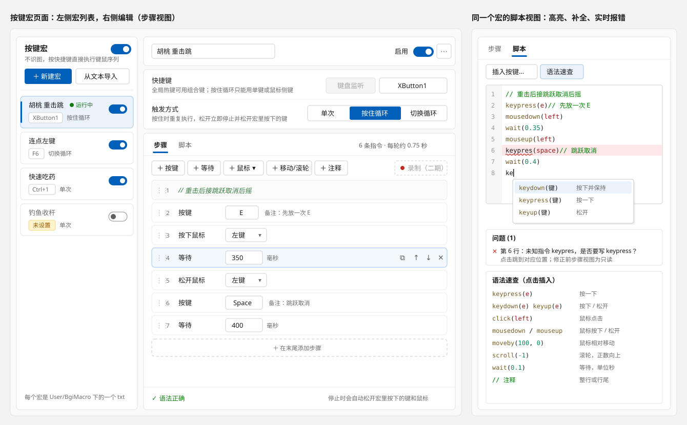
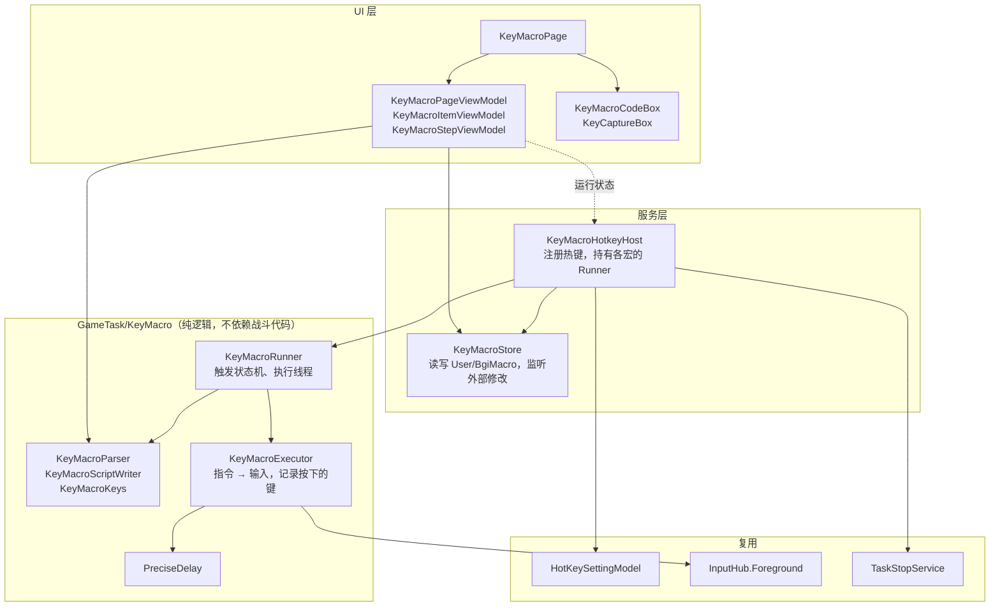

# 按键宏：不识图的键鼠宏

状态：第 2 版（2026-10-31），评审问题已全部确认（第 12 节），第一期实施中。

版本记录：

- 第 1 版：宏内容复用战斗策略的解析和指令，配置存放在 `config.json`。
- 第 2 版（本版）按评审意见修改：
  - 每个宏保存为 `User/BgiMacro` 下的一个 txt 文件，快捷键等设置写在文件开头的注释里（第 6 节）。
  - 解析和执行完全重写，不复用战斗策略的任何代码（`Method`、`CombatCommand`、`CombatScriptParser`、`Avatar` 都不引用）。
  - 只保留基础键鼠指令和 `wait`，删除 attack、walk、charge、skill、round 等包装和控制指令（第 5 节）。
  - 按住循环、切换循环在松开或再次按下时，即使一轮没执行完也立即终止。
  - 编辑时有错误照常报错；执行时跳过无法识别的指令并写警告日志，其余指令照常执行。
  - 「停止当前脚本/独立任务」热键同时停止按键宏。

## 1. 结论

- 新增「按键宏」。每个宏有自己的快捷键和触发方式，按下后直接执行键鼠序列，不截图，不识别角色。它与现有的「一键宏（按角色）」并列，互不影响。
- **内容沿用战斗策略的书写形式**（`keypress(e)`、`wait(0.5)` 这样的函数调用写法），但解析器、指令模型、执行器全部独立实现。
- **只有 9 条指令**：`keydown`、`keyup`、`keypress`、`mousedown`、`mouseup`、`click`、`moveby`、`scroll`、`wait`。按键原样发送，不经过游戏键位映射；`moveby` 原样发送相对位移，不做 DPI 缩放。
- **一个宏一个文件**：`User/BgiMacro/<名称>.txt`，文件名即宏名称。文件可以直接用记事本编辑、复制给别人；程序监听目录，外部修改会自动载入。
- **两个编辑视图，编辑同一段脚本**：「步骤」视图逐条点选、拖动排序；「脚本」视图有语法高亮、补全和实时报错。
- 三种触发方式：单次、按住循环、切换循环。

## 2. 现状与问题

一键宏的链路：热键 `OneKeyFightHotkey` → `OneKeyFightTask.KeyDown(runtime)` → 截图，`CombatScenes.InitializeTeam` 识别队伍，`CurrentAvatar` 识别出战角色 → 从 `User/avatar_macro.json` 取该角色的脚本 → `CombatCommand.Execute(avatar)`。

这条链路不能用来做纯执行宏：

| # | 问题 | 位置 |
| --- | --- | --- |
| 1 | 每次触发都要截图并识别队伍和出战角色。截图器未启动或识别失败时不执行 | `OneKeyFightTask.FightTask` |
| 2 | `CombatCommand.Execute` 只接受 `Avatar` 或 `CombatScenes`；`Avatar` 的构造需要运行环境、战斗场景和真实角色名 | `CombatCommand.Execute`、`Avatar` 构造函数 |
| 3 | `keyup(e)` 和 `keypress(e)` 会触发 E 技能冷却的 OCR 检测 | `CombatCommand.TryTriggerESkillCdCheck` |
| 4 | `wait` 不响应取消，松开热键后要等当前等待结束 | `Avatar.Wait` |
| 5 | 编辑入口是 JSON 文本对话框，脚本写在 JSON 字符串里，没有校验和提示 | `MacroSettingsPageViewModel.OnEditAvatarMacro` |
| 6 | 只有一个热键，不能给不同的动作配不同的键 | `HotKeyConfig.OneKeyFightHotkey` |

战斗策略的解析器也不适合直接用：`ParseContext` 把括号外的第一个空格当作角色名分隔符，没有角色名的 `keypress(e), wait(0.1)` 会丢掉第一条指令；未知指令会写错误日志，边输入边校验时会刷屏。所以按键宏的解析器独立实现。

## 3. 目标与非目标

目标：

1. 不懂语法的用户能在步骤视图里点选完成一个宏；会写语法的用户能直接写脚本，并实时看到出错位置和修正建议。
2. 停止及时、可靠：松开或再次按下热键后，当前等待立即结束，宏按下的键全部松开。
3. 宏执行不截图、不识图。
4. 宏文件可以在程序外编辑和分享。

非目标（首期不做）：

- 条件、分支、变量、轮次（`round`）、识图判断。
- 游戏动作指令（attack、skill 等）和游戏键位映射。
- 绝对坐标点击。
- 罗技 G HUB 的“按顺序”模式（按下、按住、松开分别执行不同片段）。
- 录制，放到第二期（第 11 节）。
- 宏列表拖动排序（列表按名称排序）。
- 在快捷键页显示按键宏的热键。

## 4. 界面与交互

### 4.1 入口

- 主导航「辅助操控」下方新增「按键宏」页面（`KeyMacroPage`）。
- 「辅助操控」页顶部新增一张卡片，包含总开关和「管理按键宏」按钮。原「一键宏（按角色）」卡片不改文字，避免已有翻译失效。

### 4.2 页面布局



**左栏：宏列表**

- 每项显示名称、快捷键和触发方式。宏正在运行时，名称旁显示绿点。快捷键未设置或注册失败时，以黄色或红色文字提示。
- 顶部：总开关、「新建」（弹出模板菜单：空白、连点左键、按住一个键、重击接跳跃）、「导入」（选择一个或多个 txt 复制到宏目录）、「打开目录」。

**右栏：编辑区**

1. 标题行：名称文本框（失去焦点时重命名文件）、启用开关、「复制」「删除」按钮。删除前用 `ThemedMessageBox` 确认。
2. 触发设置：
   - 快捷键：热键类型切换按钮加 `HotKeyTextBox`，写法同悬浮小窗设置页。选择“按住循环”时，热键类型固定为“键鼠监听”。
   - 键鼠监听类型下设置了组合键时，提示“键鼠监听不支持组合键”并清空。
   - 快捷键与原神键位冲突时显示黄色提示，判断沿用 `HotKeyPageViewModel` 中的游戏键位冲突检查。
   - 注册失败时显示红色原因。
   - 触发方式：三个单选按钮，下方说明随选择变化。
3. 内容：「步骤」和「脚本」两个标签页，页面记住上次使用的标签页。

### 4.3 步骤视图

| 步骤 | 参数控件 | 生成的脚本 |
| --- | --- | --- |
| 按键、按下键、松开键 | 按键捕获框 | `keypress(e)`、`keydown(e)`、`keyup(e)` |
| 鼠标点击、鼠标按下、鼠标松开 | 左键 / 右键 / 中键 / 侧键 1 / 侧键 2 | `click(left)`、`mousedown(right)`、`mouseup(x1)` |
| 移动鼠标 | X、Y 两个整数框 | `moveby(100, 0)` |
| 滚轮 | 整数框，正数向上 | `scroll(1)` |
| 等待 | 毫秒数字框 | `wait(0.35)` |
| 注释 | 文本框 | `// 文本` |

交互：

- 工具栏：按键、按下键、松开键、等待、鼠标（下拉：点击、按下、松开、移动鼠标、滚轮）、注释、撤销、重做。新步骤插在选中步骤之后；没有选中时追加到末尾。
- 每行的类型下拉框可以改类型，同类参数保留。
- 按键捕获框：点击后按下任意键盘键完成捕获，显示易读名称（左 Shift），写入脚本时用按键名（`lshift`）。鼠标键用鼠标类步骤，不在捕获框里捕获。
- 等待用毫秒显示和输入，写入脚本时换算成秒（350 → `0.35`）。
- 每行右侧有上移、下移、复制、删除按钮；整行可以拖动排序。Ctrl+Z / Ctrl+Y 撤销 / 重做，以脚本文本快照实现，最多 50 步。
- 每个步骤可以加备注，写入脚本时成为行尾注释。
- 标签栏右侧显示“6 条指令 · 每轮约 0.75 秒”，时长按 `wait` 累加。
- 脚本有错误时，步骤视图变为只读，并提示“脚本第 N 行有错误，请在脚本视图修正”。这样不会因为解析失败丢掉用户写的内容。
- 写回规则：一条指令一行；注释写成整行注释；备注写成行尾 `// 备注`。用户在脚本视图里一行写多条指令的排版，在步骤视图编辑后会整理为一行一条。

### 4.4 脚本视图

- `KeyMacroCodeBox` 继承现有的 `CodeBox`（AvalonEdit），提供行号、高亮、补全、错误标记。
- 高亮规则在代码里定义，不新增 xshd 文件（AGENTS.md 禁止新增 `Assets` 目录）。
- 补全：输入字母时弹出指令列表，带一句说明；在 `keydown(`、`keyup(`、`keypress(` 的括号内弹出按键名；在 `click(`、`mousedown(`、`mouseup(` 的括号内弹出鼠标键名。
- 实时校验：停止输入 300 ms 后解析。出错的行加浅红背景，出错的指令加红色波浪线。下方问题列表点击后跳到对应行。
- 「插入按键」捕获框：按下一个键后，在光标处插入 `keypress(键名)`。
- 「语法速查」面板列出全部指令，点击插入。
- 编辑即保存（500 ms 防抖写入文件），没有保存按钮。宏每次触发时使用最新内容。

### 4.5 触发方式

| 触发方式 | 按下 | 松开 | 执行中再按 | 可用热键类型 |
| --- | --- | --- | --- | --- |
| 单次 | 执行一遍 | 无作用 | 忽略 | 全局热键、键鼠监听 |
| 按住循环 | 开始循环 | 立即终止，即使本轮未执行完 | 按住期间不会再次触发 | 仅键鼠监听 |
| 切换循环 | 开始循环 | 无作用 | 立即终止，即使本轮未执行完 | 全局热键、键鼠监听 |

终止时，宏按下但还没松开的键和鼠标键全部松开。

热键类型的区别写在快捷键说明里：

- 全局热键：可以用组合键（如 Ctrl+1），按键不会传给游戏。任何窗口在前台时都会收到，执行器另外检查游戏是否在前台。
- 键鼠监听：只能用单键或鼠标侧键，按键会同时传给游戏。只在游戏位于前台、并且已在启动页启动截图器时生效。这与那维莱特转圈等现有长按类功能一致。

### 4.6 防误操作

- 宏内容里出现自己的快捷键时报错（执行时跳过该指令）：宏发出的按键会被键鼠监听收到，造成自我触发或提前停止。
- 循环模式下一轮里没有任何等待时给出警告；执行时每轮之间至少间隔 10 ms。
- `keydown` / `mousedown` 没有对应的松开时，提示“停止时会自动松开”。
- 游戏不在前台时不开始执行；执行中游戏失去前台时立即停止。

## 5. 语法

### 5.1 书写规则

| 规则 | 示例 |
| --- | --- |
| 一行写一条或多条指令，多条用 `,` 或 `;` 分隔 | `keydown(e), wait(0.5), keyup(e)` |
| 多行按顺序执行 | |
| 注释：整行 `//` 或 `#`；行尾 `//` | `keypress(space)  // 跳跃` |
| 全角括号、逗号、分号自动按半角处理 | `wait（0.5）` |
| 指令名、按键名、鼠标键都不区分大小写 | `KeyPress(E)` |
| 时间单位为秒，可写小数 | `wait(0.05)` |

### 5.2 指令

| 指令 | 参数 | 说明 |
| --- | --- | --- |
| `keypress(k)` | 按键名 | 按一下 |
| `keydown(k)` / `keyup(k)` | 按键名 | 按下并保持 / 松开 |
| `click(b)` | 鼠标键，省略为 `left` | 点击 |
| `mousedown(b)` / `mouseup(b)` | 鼠标键，省略为 `left` | 按下并保持 / 松开 |
| `moveby(x, y)` | 整数 | 鼠标相对移动，原样发送 |
| `scroll(n)` | 非 0 整数 | 滚轮，正数向上 |
| `wait(s)` | 秒，0 到 3600 | 等待，可被立即中断 |

按键名：

- 字母 `a`–`z`，数字 `0`–`9`，功能键 `f1`–`f24`；
- `space`、`enter`、`tab`、`esc`、`backspace`、`delete`、`insert`、`home`、`end`、`pageup`、`pagedown`、`up`、`down`、`left`、`right`；
- `shift`、`lshift`、`rshift`、`ctrl`、`lctrl`、`rctrl`、`alt`、`lalt`、`ralt`、`capslock`；
- `numpad0`–`numpad9`；
- 其他按键可写 Windows 虚拟键名，可带或不带 `vk_` 前缀，例如 `oem_3`、`vk_oem_3`。

鼠标键名：`left`、`right`、`middle`、`x1`（侧键 1，也可写 `xbutton1`）、`x2`（侧键 2，也可写 `xbutton2`）。`keypress` 等键盘指令不接受鼠标键，报错时提示改用鼠标指令。

战斗策略里的包装指令（attack、skill、burst、walk、charge、dash、jump、round 等）报错，提示“按键宏只支持基础键鼠指令”。

### 5.3 示例

```text
// 重击后接跳跃取消后摇
mousedown(left)
wait(0.35)
mouseup(left)
keypress(space)    // 跳跃取消
wait(0.4)
```

```text
// 连点左键
click(left), wait(0.05)
```

## 6. 文件格式与存储

宏目录：`User/BgiMacro`，不存在时自动创建。每个 `*.txt` 是一个宏，文件名（不含扩展名）是宏名称。

文件开头连续的 `// @键 值` 行是宏的设置，其余部分是脚本：

```text
// @hotkey XButton1
// @hotkeyType KeyboardMonitor
// @mode hold
// @enabled true
// 重击后接跳跃取消后摇
mousedown(left)
wait(0.35)
...
```

| 键 | 取值 | 缺省 |
| --- | --- | --- |
| `hotkey` | 热键字符串，格式同 `HotKeyConfig`（如 `F6`、`Ctrl + D1`、`XButton1`） | 空，不注册 |
| `hotkeyType` | `KeyboardMonitor`、`GlobalRegister` | `KeyboardMonitor` |
| `mode` | `once`、`hold`、`toggle` | `once` |
| `enabled` | `true`、`false` | `true` |

- 设置行本身也是注释，整个文件仍是合法脚本。
- 只识别上表中的键；遇到第一行不是已知设置的内容，脚本从这一行开始。
- 写入使用 UTF-8 无 BOM、CRLF 换行。界面修改后 500 ms 防抖写入。
- `KeyMacroStore` 用 `FileSystemWatcher` 监听目录，外部修改、新增、删除在 500 ms 防抖后载入。自己写入的内容记录下来，监听到相同内容时忽略。
- 名称规则：不能为空，不能含文件名非法字符，不能与已有宏重名（不区分大小写），最长 64 个字符。
- 总开关和上次使用的编辑视图保存在 `config.json` 的 `keyMacroConfig` 节点。

## 7. 架构

### 7.1 分层



### 7.2 新增文件

| 文件 | 职责 |
| --- | --- |
| `Core/Config/KeyMacroConfig.cs` | 总开关、上次使用的编辑视图 |
| `GameTask/KeyMacro/KeyMacroDefinition.cs` | 一个宏（名称、启用、快捷键、热键类型、触发方式、脚本）；`KeyMacroTriggerMode` 枚举 |
| `GameTask/KeyMacro/KeyMacroFileFormat.cs` | 文件内容（`KeyMacroFileContent`）的解析与生成 |
| `GameTask/KeyMacro/Script/KeyMacroCommandKind.cs` | 指令类型、鼠标键枚举 |
| `GameTask/KeyMacro/Script/KeyMacroCommandCatalog.cs` | 全部指令的名称、写法、示例、说明，解析、补全、语法速查共用 |
| `GameTask/KeyMacro/Script/KeyMacroStep.cs` | 一个步骤：指令或注释，带位置和备注 |
| `GameTask/KeyMacro/Script/KeyMacroDiagnostic.cs` | 诊断：级别、行、列范围、消息 |
| `GameTask/KeyMacro/Script/KeyMacroDocument.cs` | 解析结果 |
| `GameTask/KeyMacro/Script/KeyMacroParseOptions.cs` | 解析选项：触发方式、快捷键对应的按键 |
| `GameTask/KeyMacro/Script/KeyMacroParser.cs` | 脚本 → `KeyMacroDocument` |
| `GameTask/KeyMacro/Script/KeyMacroScriptWriter.cs` | 步骤 → 脚本文本 |
| `GameTask/KeyMacro/Script/KeyMacroKeys.cs` | 按键名、鼠标键名与虚拟键的对照，易读名称 |
| `GameTask/KeyMacro/KeyMacroExecutor.cs` | 执行指令，记录并松开按下的键 |
| `GameTask/KeyMacro/KeyMacroRunner.cs` | 一个宏的触发状态机和执行线程 |
| `GameTask/KeyMacro/PreciseDelay.cs` | 高精度、可中断的等待 |
| `Service/KeyMacro/KeyMacroStore.cs` | 宏目录的读写与监听 |
| `Service/KeyMacro/KeyMacroHotkeyHost.cs` | 热键注册、Runner 管理、运行状态 |
| `View/Pages/KeyMacroPage.xaml(.cs)` | 页面 |
| `ViewModel/Pages/KeyMacroPageViewModel.cs` | 宏列表、新建、导入、复制、删除 |
| `ViewModel/Pages/KeyMacro/KeyMacroItemViewModel.cs` | 单个宏的编辑 |
| `ViewModel/Pages/KeyMacro/KeyMacroStepViewModel.cs` | 步骤视图中的一行 |
| `ViewModel/Pages/KeyMacro/KeyMacroOption.cs` | 下拉框选项 |
| `ViewModel/Pages/KeyMacro/KeyMacroTemplates.cs` | 新建模板 |
| `ViewModel/Pages/KeyMacro/KeyMacroEditorRequest.cs` | 对脚本编辑器的请求（插入、跳转）；编辑器执行后经双向绑定清空，切换宏时不会重复执行 |
| `View/Controls/CodeEditor/KeyMacroCodeBox.cs` | 高亮、补全、错误标记、插入与跳转 |
| `View/Controls/CodeEditor/KeyMacroDiagnosticRenderer.cs` | 错误行背景和波浪线 |
| `View/Controls/CodeEditor/KeyMacroCompletionData.cs` | 补全项 |
| `View/Controls/KeyMacro/KeyCaptureBox.cs` | 捕获单个键盘键 |

## 8. 解析

`KeyMacroParser.Parse(string script, KeyMacroParseOptions options)` 返回 `KeyMacroDocument`。

1. 按物理行拆分，记录行号。全角 `（）`、`，`、`；` 按位置替换为半角，列位置不变。
2. 括号外的第一个 `//` 之后是行尾注释；以 `//` 或 `#` 开头的行是注释行。
3. 括号外的 `,` 和 `;` 分隔指令，记录每条指令的起止列。
4. 每条指令按 `名称(参数)` 或 `名称` 解析：
   - 名称转小写后查指令表。找不到时：是战斗策略的包装指令名，提示“只支持基础键鼠指令”；否则按编辑距离给出建议（keypres → keypress）。
   - 括号不配对、两条指令之间缺逗号（`keypress(e) wait(1)`）分别给出对应提示。
   - 检查参数个数和取值范围。
5. 整体检查（需要 `options`）：脚本里出现自己的快捷键（错误）；按下后没有松开（警告）；循环模式下没有等待（警告）；没有任何指令（警告）。
6. 输出：
   - `Steps`：每条指令或注释一个 `KeyMacroStep`，指令带 `IsValid`；
   - `Diagnostics`：级别、行号、列范围、消息；
   - `HasError`；
   - `Commands`：有效的指令，供执行器使用。

## 9. 执行与停止

### 9.1 指令到输入的映射

`KeyMacroExecutor` 每条指令都重新取 `InputHub.Foreground`（`InputHub` 的约定）。

| 指令 | 执行 | 记录 |
| --- | --- | --- |
| `keydown` / `keyup` / `keypress` | `Keyboard.KeyDown/KeyUp/KeyPress(vk)` | 按下时记录，松开时移除 |
| `mousedown` / `mouseup` / `click` | `Mouse.Left/Right/MiddleButtonDown/Up/Click`，侧键用 `XButtonDown/Up/Click(1 或 2)` | 同上 |
| `moveby` | `Mouse.MoveMouseBy(x, y)` | |
| `scroll` | `Mouse.VerticalScroll(n)` | |
| `wait` | `PreciseDelay` | |

### 9.2 等待精度

项目里没有调用 `timeBeginPeriod`，`Thread.Sleep` 的精度受系统计时器影响，默认约 15.6 ms。`PreciseDelay`：

- 用 `CreateWaitableTimerExW` 加 `CREATE_WAITABLE_TIMER_HIGH_RESOLUTION`（Windows 10 1803 起）创建高精度计时器，与取消令牌的 `WaitHandle` 一起 `WaitAny`，取消时立即返回。
- 按 50 ms 分段，段间检查停止条件；用 `Stopwatch` 计算截止时间，分段不累积误差。
- 计时器按线程复用；创建失败时退回 `WaitHandle.WaitOne`。

### 9.3 Runner 与停止条件

每个宏一个 `KeyMacroRunner`。

- 键鼠监听类型挂 `OnKeyDownAction` / `OnKeyUpAction`。长按时键盘钩子会重复触发 KeyDown，Runner 用“热键是否按住”标志过滤。
- 全局热键类型只挂 `OnKeyPressAction`，并设置 `SuppressRepeat = true`。
- 是否在运行以执行线程是否存活为准。
- 执行线程是独立的后台线程，优先级 AboveNormal。不同的宏可以同时运行，各自松开自己按下的键。
- 每次开始时解析最新脚本（按脚本文本缓存）。无效指令跳过，并写一条警告日志列出前几处错误。

| 停止条件 | 检查位置 |
| --- | --- |
| 按住循环：松开快捷键 | KeyUp 回调；兜底：开始 150 ms 后，每条指令前和等待的每个分段之间用 `GetAsyncKeyState` 查快捷键物理状态（聊天框保护或切出游戏时 KeyUp 不会送达） |
| 切换循环：再次按下 | KeyDown / 按键回调 |
| 单次：一遍执行完 | 执行线程 |
| 游戏不在前台 | 开始前、每条指令前、等待的每个分段之间（`SystemControl.IsGameForeground`） |
| 总开关关闭；宏被禁用、删除、改名；快捷键或触发方式变化 | `KeyMacroHotkeyHost` |
| 「停止当前脚本/独立任务」热键、截图器停止、程序退出 | `TaskStopService` 注册的回调 |
| 执行异常 | 执行线程捕获并记录错误日志 |

松开按键只在执行线程的 `finally` 中进行。等待都能立即中断，取消后执行线程很快就会进入 `finally`。

日志：开始和停止各记一条，写明宏名称和停止原因；不逐条记录指令。

## 10. 热键注册

`KeyMacroHotkeyHost` 注册为单例和托管服务：

- 启动时在 UI 线程载入宏目录，订阅宏列表、每个宏和总开关的变化，200 ms 防抖后只重建签名变化的宏（名称、快捷键、类型、触发方式、启用）。
- 每个宏创建一个 `HotKeySettingModel`，`ConfigPropertyName` 为 `"KeyMacro/{名称}"`。
- 以下情况不注册：总开关关闭、宏被禁用、快捷键为空、云原神网页版实例（与应用热键规则相同）。
- 冲突：先按 `HotKeyConfig` 预检查（与 `PuloniaTaskTriggerHost` 共用 `HotKeySettingModel.ConflictsWithHotKeyConfig`），再调用 `RegisterHotKey`。失败原因保存在宿主中，界面显示在快捷键下方。冲突提示改为“……其他功能、任务计划或按键宏使用”。
- 在 `Dispatcher.ShutdownStarted` 时注销全部热键。

## 11. 分期

第一期：文件存储、解析、写回、执行、Runner、热键宿主；页面（列表、模板、导入、触发设置、步骤视图、脚本视图）。

第二期：

- 录制：在编辑器里录制键盘键和鼠标按键及其间隔，生成 `keydown` / `keyup` / `wait`。
- 快捷键页增加只读的「按键宏」分组。
- “按顺序”模式。

## 12. 已确认的问题

| # | 问题 | 结论 |
| --- | --- | --- |
| 1 | 功能名称 | 「按键宏」 |
| 2 | 入口 | 新增导航项，辅助操控页加卡片 |
| 3 | 存储 | 每个宏一个 txt，目录 `User/BgiMacro` |
| 4 | 游戏动作指令 | 不支持；编辑时报错，执行时跳过并写警告 |
| 5 | 键鼠监听热键需先启动截图器 | 保持现状 |
| 6 | 「停止当前脚本/独立任务」热键是否停止按键宏 | 是 |
| 7 | 独立任务运行时是否禁止按键宏 | 不限制 |
| 8 | 录制 | 第二期 |
| 9 | 是否修改战斗策略的 `Method` | 不改；按键宏不引用战斗策略代码 |
| 10 | 按住循环、切换循环终止时机 | 松开或再次按下时立即终止，即使本轮未执行完 |
