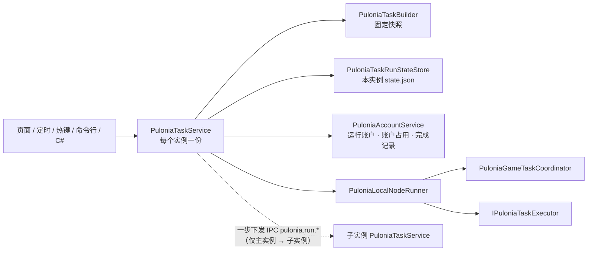
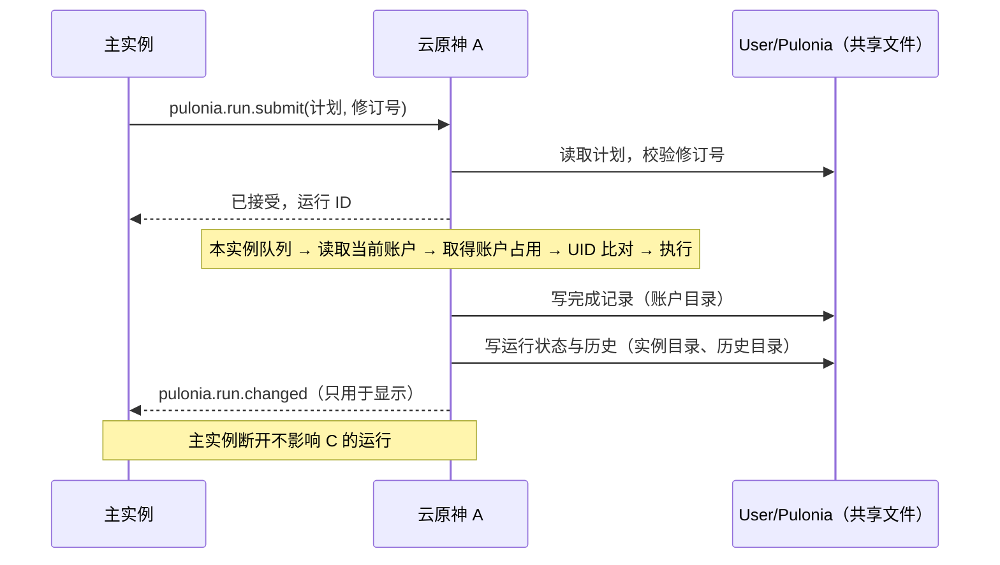

# Pulonia：执行、恢复与 API

[返回总览](README.md) · [用户故事](requirements.md) · [路线图](roadmap.md)

说明一次运行如何排队、执行、取消、判定结果和续跑，以及如何从 C# 接入。路线 CD 和落盘语义见[结果、CD 与存储](results-and-storage.md)。2026-10-24 按当前代码核对。实施状态：按[实例、账户与路线 CD 统筹设计](../instance-account-model.md)改写，代码已于 2026-11-01 实施，待用户验收，见[统筹设计第 15 节](../instance-account-model.md#15-实施记录)。

## 执行结构与资源生命周期



| 部分 | 职责 |
| --- | --- |
| `PuloniaTaskService` | 统一入口（实现 `IPuloniaTaskService`）、本实例的串行队列、准入复核、确定运行账户、快照树编排、路线 CD 判定、运行预览、重试、最终状态、归档、续跑。每个实例各有一份，都是协调器，都检查本实例负责的定时触发器；主实例另负责计划热键和向子实例一步下发。由 `.Accounts`、`.RouteCooldown`、`.RunState`、`.Scheduling` 等 partial 组成；`RunState` 是其内部的可变运行状态。一步下发的收发在 `Pulonia/Remote/`：主实例的 `PuloniaRunDispatcher`、子实例的 `PuloniaRunDispatchHost` |
| `PuloniaAccountService` | 实现 `IPuloniaAccountService`，属于应用服务层：账户目录、实例当前账户、账户占用、切换前检查、UID 比对和账户进度（完成记录、首领领奖次数）读写。存储仍由 `PuloniaTaskStore` 负责，账户相关部分拆为 `PuloniaTaskStore.Accounts` 和 `PuloniaTaskStore.AccountProgress` 两个 partial。`PuloniaTaskService` 通过它确定运行账户、判定和写入完成记录，不再直接持有账本 |
| `PuloniaTaskRunStateStore` | 本实例 `User/Pulonia/instances/<目录名>/state.json` 的内存副本与唯一写入入口，只由本实例写入，写入失败时熔断，见[存储](results-and-storage.md#实例运行状态)。不再包含完成记录 |
| `PuloniaLocalNodeRunner` | 本进程执行一次节点尝试或一次账户准备；每个实例各持一份，代码相同 |
| `PuloniaGameTaskCoordinator` | 发放游戏任务租约 `PuloniaGameTaskLease` |
| `IPuloniaTaskExecutor` | 6 个具体执行器，按 `Definitions` 声明的任务类型注册，类型重复注册时启动报错 |
| `PuloniaTaskTriggerHost` | 后台托管服务，每个实例都运行：每秒调用定时检查，只处理本实例负责的定时触发器；命令行 `--pulonia-run` 在启动参数所在的实例本地提交；只有主实例的这项服务注册计划热键。见[触发与热键](scheduling.md) |

能力是否需要游戏由 `PuloniaTaskDefinition.RequiresGameSession` 声明：路线、JS、键鼠和独立任务需要，Shell 与 C# 不需要。不需要游戏的节点不取租约，也不启动截图器。

### 游戏任务租约

`PuloniaGameTaskCoordinator.AcquireAsync` 的顺序：

1. 当前已在任务会话中（`GameTaskSessionScope.IsActive`）时直接报错“当前已在任务会话中，不能再次获取游戏任务租约”，嵌套获取不会死锁。
2. 等待全局任务锁 `TaskControl.TaskSemaphore`，与独立任务、旧配置组互斥。
3. `GameRuntimeService.StartAsync` 按需准备运行环境；环境为空或正在停止时报错。
4. 等待订阅脚本自动更新结束，最长 10 分钟，超时报错且本节点不执行。
5. 进入任务模式（触发器调度、遮罩、窗口激活）并返回租约。

释放租约时释放 `InputHub` 全部按键、清理遮罩并归还任务锁，游戏会话保留供下一个节点复用。任一步失败都会先清理再归还锁。`PuloniaGameTaskCoordinator` 与 `TaskRunner` 仍各有一份会话代码，合并为统一的 `GameTaskLease` 见 [task-contract.md](../task-contract.md) 步骤 D，尚未实施。

## 队列与执行顺序

每个实例有自己的串行队列，一次只执行本实例的一个运行。不同实例的队列并行，同一账户由[账户占用](../instance-account-model.md#45-账户占用)保证不会同时运行。队列中的请求来自本实例的页面、命令行、C# 调用和本实例负责的定时触发器；主实例的队列还接收计划热键，子实例的队列还接收主实例一步下发的运行。消费循环由 `SemaphoreSlim` 信号唤醒，每次挑选“停止当前”策略触发的请求优先，其余按提交时间先后。

一次运行的顺序：

1. **准入复核**（仅触发器请求，在执行实例出队时）：重新读取计划，触发器已删除、停用、配置版本变化或计划的运行账户设置变化时记为“已取消”；超过截止时间记为“已过期”；读不出计划记为“待处理”。
2. **确定运行账户**（计划含启用的游戏节点时执行，普通计划和一条龙相同；只有 Shell、C# 节点的计划不确定运行账户）。实例当前账户在这时读取最新设置，而不是在提交时读取：队列中前一个运行切换了账户，后面跟随当前账户的运行就为切换后的账户执行。规则见[统筹设计 4.4](../instance-account-model.md#44-运行开始时确定运行账户)：
   - **跟随当前账户**（计划 `account_id` 为空）：运行账户就是本实例当前账户；当前账户为“未确定”时进入待处理，提示先设置本实例当前账户。取得账户占用后做 UID 比对：当前账户填写了 UID 且游戏此时停在主界面时读取一次 UID，只截图、不按键，最多约 3 秒。不一致时遮罩日志警告并通知，运行照常进行，进度仍记在实例当前账户名下；读不到或当前账户没有 UID 时记为未比对，不提示。节点执行中不再读取 UID。
   - **指定账户**（`account_id` 为 `acc_…`）：先取得目标账户的占用，取得失败时直接进入待处理，不切换。然后沿用现有切号器，回到主界面读取 UID，等于目标账户的 UID 时不切换。不等于时，只有本机 PC 官服窗口（主实例或桌面分身）且目标账户有登录资料才切换。切换前做[切换前检查](../instance-account-model.md#46-切换前检查)：另一个在线实例的当前账户就是目标账户时，本实例界面手动运行先提示确认，触发器提交和主实例下发则不切换、进入待处理。切换后读取 UID，必须与目标账户一致。云原神实例或目标账户没有登录资料时不能切换，进入待处理：“游戏中登录的不是乙，本实例不能切换到乙”。核验成功后把实例当前账户改为目标账户，核验结果与“切换账户”节点结果一起落盘后才执行业务节点。切换中途失败（例如已登出、停在登录界面）时，实例当前账户改为“未确定”。切号与核验细节见[多账户](accounts.md)。
   - 取得账户占用失败时进入待处理，不排队等待。
   - 运行记录写入 `account_id`、`account_source`（`instance_current` 或 `specified`）、`verified_uid`（只在指定账户时有值）和 `uid_check`（只在跟随当前账户时有值：`matched`、`mismatched` 另记读到的 UID，或 `skipped`）；路线 CD 的服务器偏移按运行账户的 `server_time_zone` 写入。
   - 运行账户不能确定（当前账户未确定、占用冲突、不能切换、切换或核验失败）时，整次运行进入待处理，不执行业务节点。
3. **深度优先遍历快照树**，对每个叶子：
   1. 禁用、或续跑时已确认完成的节点记为跳过；
   2. 地图追踪节点按运行账户的完成记录判定路线 CD（判定前比较文件修改时间，有变化才重新读取），仍在 CD 内或一次性已完成则跳过（原因码 `pathing.cooldown_active` / `pathing.cooldown_completed`，并更新当前节点消息）并继续后续节点；
   3. 每次尝试：需要游戏时由 `PuloniaLocalNodeRunner` 取游戏租约；指定账户的运行再核验 UID，然后调用执行器；
   4. 节点结果落盘。地图追踪成功时按固定顺序写两处：先在 `.writer.lock` 内把完成记录写入运行账户的 `accounts/<账户 ID>/route-completions.json`，写入后触发 `AccountProgressChanged`；再把节点结果和本次完成的路线写入本实例 state.json。两步之间崩溃时完成记录已经存在，运行在重启后转为“已中断”，续跑或下次运行会按 CD 跳过这份路线。完成记录写入失败时按现有规则熔断，停止本实例的自动运行。其他节点只写 state.json。见[统筹设计 5.4](../instance-account-model.md#54-写入顺序)；
   5. 失败按 `max_retries` 和 `retry_delay_seconds` 重试，耗尽后按 `failure_behavior` 编排。
4. **最终状态**：执行器全部退出后由 `ResolveFinalStatus` 一次判定。
5. **归档**：运行先进入本实例 state.json 的 `pending_archives`，写入共享历史目录的不可变历史后移出。

取租约在每次尝试内完成，不跨重试持有：运行环境停止后，下一次尝试会重新准备。取租约失败按普通节点失败进入重试。CD 判定在取租约之前，CD 内的节点不会占用游戏。指定账户的运行，每个需要游戏的节点尝试在取得输入后都会按现有规则再次核验 UID（是否改为只在准备和恢复后核验待定 D7）；核验失败抛 `PuloniaGenshinAccountException`，不进入节点重试，整次运行转为待处理。跟随当前账户的运行不做节点核验。

当前执行节点的地址只在内存中更新，不为它单独写盘；续跑和中断恢复只依赖快照与已落盘的节点结果。

### 运行状态与最终判定

运行状态 `PuloniaTaskRunStatus`：Queued、Running、Cancelling、Succeeded、Failed、Cancelled、TimedOut、Interrupted、NeedsAttention、Expired。节点状态 `PuloniaTaskNodeStatus`：Skipped、Succeeded、Failed、Cancelled、TimedOut、NeedsAttention。执行器返回的完成程度 `PuloniaTaskOutcomeKind`：Succeeded、ExecutedUnverified、PartiallySucceeded、Failed、Cancelled、Skipped、NeedsAttention（两套节点枚举的合并待定）。

`ResolveFinalStatus` 的判定顺序：

1. 运行令牌已取消且流程以取消结束：总时限到期且没有显式停止时为 TimedOut，否则为 Cancelled。
2. 运行账户不能确定（含账户占用冲突），或 UID 核验失败：NeedsAttention。
3. 其他异常：关键状态写入已熔断时为 NeedsAttention，否则为 Failed（执行基础设施失败）。
4. 计划走完：有节点在重试耗尽后失败时为 Failed，否则为 Succeeded。

判定只看执行结果和异常，不比较进度文字。

## 跨实例执行（一步下发）

本节替换原“跨实例派发”一节，原锚点 `#跨实例派发` 不再存在，引用处应改指本节。规则见[统筹设计 6.2](../instance-account-model.md#62-每个实例自己协调运行)、[6.3](../instance-account-model.md#63-一步下发)。

规则：

- **每个实例自己协调。** 子实例从自己界面、自己的定时触发器或命令行 `--pulonia-run` 提交的运行都在本实例执行，不经过 IPC，主实例不在线时也能运行。
- **执行实例**以实例键标识：主实例 `primary`、桌面分身 `child_session`、云原神实例 `webview:<小写实例名>`。桌面分身的实例键不带会话号；原 `PuloniaTaskExecutionTarget` 已删除。
- **主实例只整次下发。** 一步下发只用于主实例界面上的手动运行（“运行于”选择了子实例），使用以下操作：

| 操作 | 方向 | 内容 |
| --- | --- | --- |
| `pulonia.run.submit` | 主 → 子 | 计划 ID、计划修订号、执行范围（`target_task_id`） |
| `pulonia.run.cancel` | 主 → 子 | 运行 ID |
| `pulonia.run.changed` | 子 → 主 | 运行 ID、状态、当前节点消息。只回报主实例下发的运行 |

- 子实例收到 `pulonia.run.submit` 后读取共享的计划。修订号不一致时拒绝，提示“计划已变更，请重新运行”；一致时生成快照，放入本实例队列，立即回复运行 ID。
- 之后的确定运行账户、快照树编排、路线 CD 判定、节点结果、运行状态和历史都在子实例完成和落盘。运行账户由子实例按[队列与执行顺序](#队列与执行顺序)第 2 步确定，使用子实例的当前账户。
- “运行于”可以多选，对每个执行实例各下发一次；指定账户的计划只能选一个执行实例。提交前按[账户占用](../instance-account-model.md#45-账户占用)检查各实例的当前账户是否重复。
- “运行于”只列出在线的子实例。
- 主实例崩溃或 IPC 断开时，不取消子实例已接受的运行。断开期间主实例页面把这些运行显示为“连接断开，状态未知”，不能远程停止，需要在子实例界面停止。子实例重新连上主实例后，补发一次主实例所下发、尚未结束的运行状态。主实例的正常退出仍受退出保护限制（统筹设计 A2）。
- **停止**：每个实例只能停止本实例的运行；主实例还可以用 `pulonia.run.cancel` 停止自己下发的运行。主实例的停止热键只作用于主实例本地的运行。子实例上的运行在子实例本地停止（页面、停止热键、截图器停止、应用关闭）；其中主实例下发的运行也可以在主实例页面停止。
- **执行记录**：运行记录增加 `instance`。历史目录 `User/Pulonia/history/` 由所有实例共用，每个实例只写自己的运行。任一实例的执行记录页都显示全部实例的运行：已结束的从历史目录读取，排队和运行中的只读各实例的 state.json。
- 方向规则不变：子实例不能向主实例或其他子实例下发运行。
- 定时和热键都不经过 IPC：定时触发器由执行实例自己检查，到点时在本实例本地提交，进入本实例的队列，主实例不替子实例检查定时，也不替它下发；计划热键只在主实例注册、只在主实例执行。见[统筹设计 6.4](../instance-account-model.md#64-触发器)和[触发与热键](scheduling.md#运行边界)。
- `pulonia.node.start`、`pulonia.node.cancel`、`pulonia.node.finished`，以及 `PuloniaRemoteExecutionBroker` 和 `PuloniaRemoteNodeHost` 已删除，约 900 KB 的派发负载上限也不再需要。`pulonia.node.report`、执行通道和 `remote_active_runs` 此前已删除。



协议细节见[多实例命名管道协议](../multi-instance-ipc.md)。子实例会写 `User/Pulonia`（原待定 D15 的结论），`.writer.lock` 和账户目录的修订号保留。

## 取消、时限与线程

- 每次运行有独立的 `CancellationTokenSource`，与总时限、应用关闭关联；节点超时另建关联令牌。运行开始时向执行它的实例的 `TaskStopService` 注册取消回调，结束时注销；每个实例只注册本实例执行的运行。
- 取消请求不等于停止完成：状态先变为 Cancelling，等执行器退出、释放按键与资源后才判定 Cancelled 并放行本实例队列的下一项。
- 主实例取消自己下发的运行时发送 `pulonia.run.cancel`，由子实例按同样的流程取消，状态经 `pulonia.run.changed` 回报。主实例断开或退出不会取消子实例已接受的运行。
- 请求的 `TimeoutSeconds` 为 null（默认）时不建立总时限；页面和触发器不提供总时限输入。请求的 `DeadlineUtc` 只控制能否开始，与运行总时限分开。
- “停止当前”忙碌策略只对触发器请求生效，作用于本实例：在本实例队列中入队写盘成功后，调用本实例的 `TaskStopService.StopAll`，会停止本实例所有已注册的运行，而不只是同一计划；其他实例的运行不受影响（限定范围或删除该策略待定 D8）。
- Shell 异步读取输出并记录退出码；超时或取消时结束本次拥有的进程树并确认退出。
- WPF 窗口、钩子和依赖消息循环的对象在 UI 线程建立与释放；执行、扫描、索引在后台，服务层不依赖 `Dispatcher`。

## 异常恢复

路线图步骤 8（有界恢复）暂缓，以下是设计方向，**尚未实现**。当前实现中，账号准备与核验失败、关键状态写入失败会进入待处理；其余异常按节点失败处理。按统筹设计，“账号准备与核验失败”扩展为运行账户不能确定（含账户占用冲突）和 UID 核验失败。

| 场景 | 建议行为 |
| --- | --- |
| 加载中、短暂网络波动 | 在超时预算内等待目标状态，有限次重试，避免连续点击 |
| 已知日切月卡、已知奖励弹窗 | 由专用处理器处理，确认界面稳定后继续 |
| 进入已知剧情/菜单 | 按明确识别结果退出；任务重新准备起始状态 |
| 被顶号、需要验证码、UID 不符 | 停止该账户的自动执行，进入待处理，不无限重登抢号 |
| 游戏退出、截图失效 | 按配置重建会话，重新核验 UID 和游戏状态 |
| 背包空间不足、任务所需资源不足 | 返回明确原因并退出该能力，不自动销毁物品 |
| 版本更新或未知界面 | 保存诊断截图及步骤；有限恢复仍未知则待处理 |

恢复动作不能与业务动作同时发送输入；任务内部重试与公共恢复共享总时长和总次数预算。游戏输入后必须等待响应再识别，不能用旧帧判断成功。不承诺“未知界面都能自动恢复”，只在明确预算内尝试并给出可续跑的位置。

## 续跑

`ResumeAsync(runId, startTaskAddress?, allowUncertainReplay)` 沿用历史运行的原快照建立新运行，新运行的 `resumed_from_run_id` 指向原运行：

- **继续上次**：跳过原运行中已确认成功（节点 Succeeded 且完成程度 Succeeded）的节点地址，执行其余节点；“已执行、未核验”的节点不算完成。
- **从此节点开始**：显式起点之前的节点视为已完成，起点及之后的节点重新执行（已确认成功的也可能重复，界面会要求确认）。
- 原运行处于待处理，或任一节点最后一次结果不确定（NeedsAttention 或 ExecutedUnverified）时，必须传 `allowUncertainReplay=true`；界面在用户确认后才传。
- 续跑前复核快照中的资源：仓库资源从原已确认版本的保留归档重新计算指纹，本地资源重新计算文件或 JS 指纹；不一致或已不可用时拒绝续跑，提示按新版本重新运行。
- 续跑在发起续跑的实例中执行，沿用原运行的运行账户和路线 CD 服务器偏移，规则见[统筹设计 4.4](../instance-account-model.md#44-运行开始时确定运行账户)：
  - 原运行是指定账户的，按指定账户的规则核验原 `verified_uid`，登录时使用该账户的当前凭据。
  - 原运行是跟随当前账户的，要求本实例当前账户与原运行账户相同，不同时提示先修改；相同则照常做 UID 比对。

只支持节点级续跑，不要求任意 JS、Shell 或 C# 从某一行恢复。

## C# 接口

进程内接口，每个实例的 DI 中各注册 `IPuloniaTaskService` 和 `IPuloniaAccountService` 一份。外部进程客户端（命名管道或 HTTP）不在当前范围；实例之间只有[一步下发](#跨实例执行一步下发)的 `pulonia.run.*`。

```csharp
namespace BetterGenshinImpact.Pulonia.Services;

public interface IPuloniaTaskService
{
    IReadOnlyList<PuloniaTaskDefinition> Definitions { get; }
    string? RecoveryNotice { get; }                       // 启动恢复提示：备份回退、中断运行、跳过的坏历史等
    event EventHandler<PuloniaTaskRunChangedEventArgs>? RunChanged;

    Task<string> EnqueueAsync(PuloniaTaskRequest request, CancellationToken ct = default);   // 返回运行 ID
    // 子实例接受 pulonia.run.submit：修订号不一致时拒绝，一致时与本地提交相同地入队
    Task<string> EnqueueDispatchedAsync(string planId, long planRevision, string? targetTaskId,
        CancellationToken ct = default);
    Task<PuloniaTaskRunView> GetRunAsync(string runId, CancellationToken ct = default);
    Task<IReadOnlyList<PuloniaTaskRunView>> ListRunsAsync(CancellationToken ct = default);
    Task<PuloniaTaskRunView> WaitForCompletionAsync(string runId, CancellationToken ct = default);
    Task CancelAsync(string runId, CancellationToken ct = default);
    // 只发出取消、不等待执行器退出，供 pulonia.run.cancel 使用
    Task RequestCancelAsync(string runId, CancellationToken ct = default);
    Task<string> ResumeAsync(string runId, string? startTaskAddress = null,
        bool allowUncertainReplay = false, CancellationToken ct = default);
    // accountId 为界面临时查看的账户；为空时按计划的运行账户设置选择
    Task<PuloniaTaskRunPreview> PreviewAsync(PuloniaTaskRequest request, string? accountId = null,
        CancellationToken ct = default);

    // 定时检查：每个实例都调用，只处理本实例负责的定时触发器
    Task CheckTriggersAsync(IReadOnlyList<PuloniaTaskPlan> plans,
        IReadOnlyCollection<string>? unreadablePlanIds = null, CancellationToken ct = default);
    // 计划热键：只在主实例调用
    Task FireHotkeyAsync(string planId, string triggerId, CancellationToken ct = default);
    // 只含本实例处理过的触发器：本实例负责的定时，主实例另含计划热键
    IReadOnlyList<PuloniaTaskTriggerStatus> GetTriggerStatuses();
}
```

```csharp
namespace BetterGenshinImpact.Pulonia.Services;

public interface IPuloniaAccountService
{
    // 账户目录 User/Pulonia/accounts.json；狛荷屋也从这里读取 UID 列表、订阅账户变化
    Task<PuloniaGenshinAccountSettings> LoadAccountsAsync(CancellationToken ct = default);
    event EventHandler? AccountsChanged;

    // 实例当前账户：instances/<目录名>/settings.json 的 current_account_id；null 表示“未确定”
    Task<string?> GetCurrentAccountIdAsync(string instanceKey, CancellationToken ct = default);
    Task SetCurrentAccountAsync(string instanceKey, string? accountId, CancellationToken ct = default);

    // 账户进度：完成记录 accounts/<账户 ID>/route-completions.json
    Task<IReadOnlyList<PuloniaRouteCompletion>> ListRouteCompletionsAsync(string accountId,
        CancellationToken ct = default);
    Task<int> ClearRouteCompletionsAsync(string accountId, IReadOnlyCollection<string> routes,
        CancellationToken ct = default);                  // routes 为路线身份，返回删除的条数
    event EventHandler<PuloniaAccountProgressChangedEventArgs>? AccountProgressChanged;
}
```

`IPuloniaAccountService` 只列出主要成员。路线 CD 的三个成员按[统筹设计 5.7](../instance-account-model.md#57-命名与代码对照)命名，其余成员以代码 `Pulonia/Services/IPuloniaAccountService.cs` 为准。账户目录保存、首领领奖次数、在线判断和 UID 比对结果等成员这里不列出。

```csharp
namespace BetterGenshinImpact.Pulonia.Executors;

public interface IPuloniaTaskExecutor
{
    IReadOnlyList<PuloniaTaskDefinition> Definitions { get; }

    Task<PuloniaTaskOutcome> ExecuteAsync(PuloniaTaskPreparedTask task,
        PuloniaTaskExecutionContext context, CancellationToken ct);
}
```

调用示意：

```csharp
// 返回运行 ID（run_yyyyMMdd-HHmmss-xxxx）；排队时不要求游戏或截图器已启动。
var runId = await puloniaTasks.EnqueueAsync(new PuloniaTaskRequest { PlanId = planId }, ct);
var view = await puloniaTasks.WaitForCompletionAsync(runId, ct);
```

- 请求 ID 与运行 ID 合一。调用方的 `ct` 只控制提交或等待本身，不取消已提交的运行；取消必须调用 `CancelAsync`。
- 每个实例的 `IPuloniaTaskService` 都接受本地提交，运行在本实例执行。
- 请求的 `ServerUtcOffsetMinutes` 不再在入队时填写，改为运行开始确定运行账户时按运行账户的 `server_time_zone` 填写，续跑沿用原运行。
- 请求不再带账户 ID。运行账户只由计划的运行账户设置和执行实例的当前账户决定，续跑按原运行确定。
- 路线 CD 的读取、清除和变化通知从 `IPuloniaTaskService` 移到 `IPuloniaAccountService`：`ListLedgerAsync`、`ClearCollectionCooldownAsync`、`LedgerChanged` 改为按账户的 `ListRouteCompletionsAsync`、`ClearRouteCompletionsAsync`、`AccountProgressChanged`。本进程写入完成记录后立即触发 `AccountProgressChanged`；其他实例的写入靠文件修改时间比较发现，账户进度的读写不经过 IPC。
- `PuloniaTaskExecutionContext` 向执行器提供 `RunId`、`Snapshot`、`Attempt`、`TaskAddress` 和本次租约的 `Runtime`；执行器用 `TryGetRuntime` 取运行环境，为空或已停止时节点失败。
- 结果只通过返回的 `PuloniaTaskOutcome` 表达（`Kind`、`Message`、`Data`、`Evidence`、`ReasonCode`）。通用完成事件报告已随额度框架删除。
- C# 能力由编译后 DI 注册的执行器或 `PuloniaCSharpTaskRegistry` 中的显式委托提供，不做程序集扫描或反射猜测方法；导入旧 `MethodPath` 时报告不支持。
- 尚未实现的方向：同一运行内的子调用入口（继承取消、输入所有权和记账，不再入全局队列），以及 JS 桥接的结构化结果。
